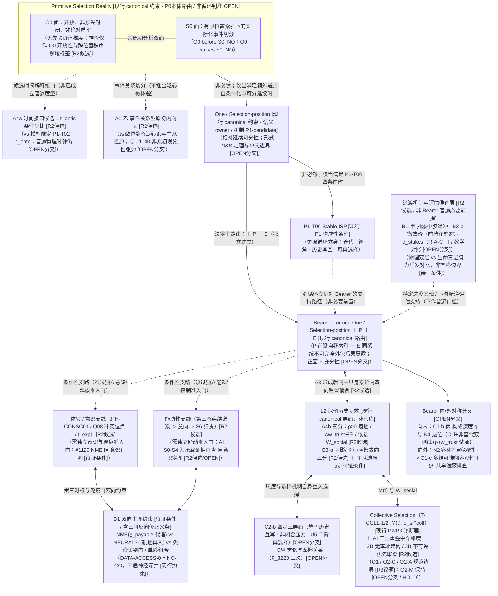

# `R1–R2` 全库直觉整理与跨仓理论关系整合总报告（2026-11-22）

> **治理定位（`canonical: false`）：** 本报告是五阶段重建规划（[`SRT_AUTHOR_DECISION_FIVE_STAGE_SRT_RECONSTRUCTION_2026-11-22.md`](../../01_Source_Intuition/SRT_AUTHOR_DECISION_FIVE_STAGE_SRT_RECONSTRUCTION_2026-11-22.md)）中 **`R1` 尾池清筛与 `R2` Theme A–D 跨仓整合** 的正式交付草案，与 **`R3` 骨架裁决议程** [`SRT_R3_SKELETON_ADJUDICATION_AGENDA_2026-11-22.md`](SRT_R3_SKELETON_ADJUDICATION_AGENDA_2026-11-22.md) 互为双向引用。
>
> **严守边界：** 本文件不改动 `STATUS.md`、`CURRENT NEXT`（仍为 `R2`）、任何 canonical / Freeze-A 文件、[`scripts/build_srt_context_bundles.py`](../../scripts/build_srt_context_bundles.py)、`Glossary/SRT_Live_Term_Router.md`、实验代码或任何现行 `HOLD`（`CN-2 E2`、`§10.1`、`§10.2`、`O2-M`、`1B` 模拟、`DATA-ACCESS-0 = NO-GO`、`RQ-2026-08-A02` 符号禁运）。历史私密库中的 `25` 条 `validation_holdout` 保持严格密封未拆。

---

## 1. 核心总图：全局生成关系与未闭合问题图

本图是 `R2` 整合的核心产物，供进入 `R3` 骨架裁决前检验理论生成主轴与真正尚未闭合的断裂点。全图严格遵守现行 [`Core_Law/SRT_Generative_Ontology_Spine.md`](../../Core_Law/SRT_Generative_Ontology_Spine.md) 的共原初性与非同一性边界：

1. **共原初双面（`Spine §2`）：** `O0` 与 `S0` 同属 `Primitive Selection Reality` 两个共原初分析面，严禁写成 `O0 → S0` 或 `O0 → Primitive Selection` 的时间先后或生成因果；
2. **形成非必然性（`Spine §5`）：** `Primitive Selection → One` 须明确附加 **递归自条件化与相对延续可分离性**，不得画成每次 `Selection` 必然生成 `One`（无历史终端选择亦真）；
3. **时间接口降格：** `Primitive Selection` 与 $\tau_{\text{ontic}}$ 仅保留虚线**候选时间解释接口**，不宣称普遍物理时间度量已成立；
4. **`Bearer` 法定主路由保持纯净（`Spine §8`）：** `Bearer` 现行准入路由只使用 **`formed One / Selection-position + P + E`**；`B1-甲`（中膜缓冲）、`B3-b`（微效价）与 `d_stakes` 均放在候选过渡机制或评估层，不篡改 `Bearer` 普遍必要条件；
5. **下游条件性分叉（`Spine §8`）：** `Bearer` **不自动推出** 关切、能动性、主体性、意识或现象性；`Bearer → Consciousness / Agency` 全部标为带独立准入门的虚线条件关系；
6. **四类认识论标签分工：**
   - **`[现行 canonical 约束]`**：`Spine` 或现行规范文件已锁定的结构约束（包含本体路由、语义 owner、已登记 P1 条件，**不等同于已获全面经验证明**，其中具体实现机制与正面充分性大多仍待检验或 `OPEN`）；
   - **`[R2 候选]`**：`R1–R2` 对话已形成方向性收敛、待 `R3` 骨架裁决落位的候选关系；
   - **`[待证条件]`**：`P3/P4` 可反驳桥梁假说或条件性实现机制；
   - **`[OPEN 分叉]`**：结构或充分性尚未闭合的真难题。

---

## 2. 来源—主张—owner—冲突—候选修改—三阶反向修正条件矩阵

> **三阶失败与反向修正纪律：** 按 `R2` 收敛原则，任何竞争理论拟合或机制反例均严禁直接外推为“推翻整个 SRT”，必须明确落在下列三阶中的具体一层：
> - **Ⅰ 阶（任务增量撤回）：** 撤回某具体任务/范式下 SRT 模型相比成熟平替的额外经验预测增量；
> - **Ⅱ 阶（机制必要性撤回）：** 撤回某候选生理/认知实现载体（如慢星形胶质资格迹、`中膜`、`微效价`）对上层功能的**唯一或普遍必要性**；
> - **Ⅲ 阶（本体结构修订）：** 仅当跨领域形成不可修复的反例集或同源张力时，修订骨架结构主张。

| 主题/子题 | 关键来源（`H` 历史 / `A` 裁决 / `M` 桥接） | `R2` 收敛候选主张 | 当前或目标 owner 表面 | 识别出的冲突 / 张力 | `R3/R4` 候选修改与位置 | 失败条件与对应三阶反向修正目标 |
|---|---|---|---|---|---|---|
| **A1** 原初内向面 | `Q01` (`F_4804`, `F_4749`, `F_5318`); `A1-乙`; `#1140` (`B` 路线) | 原初现实是物自体级 `Selection` 存在；物理表象与原初事件关系内向面呈**平行选择性抽取**，无主从还原 | `Core_Law/SRT_Generative_Ontology_Spine.md`; `Philosophy/SRT_HardProblem_Epistemology.md` | 与微粒静态泛心论、`HP-B`（`2026-09-06` “without primitive phenomenality”）存在边界张力 | `R3` 对 `#1140` 执行二轮审查后决定 `Spine` 如何划定前主体感受面 vs 成熟体验 | **Ⅱ/Ⅲ 阶：** 若事件关系内向面无法与“非原初现象性”区分且滑回微粒泛心论，则撤回原初内向面表述，退回纯形成后 `HP-B` |
| **A2** 四界去拟人化 | `Q02` (`F_4817`, `F_2675`); `A2-甲`; `F_6702` | `物择/生物择/人择` 对应既有形成层级；**`神择` 仅为 `O0` 开放性与跨位置涌现秩序视域标签**，非第 4 机制 | `Core_Law/SRT_Generative_Ontology_Spine.md`; `Glossary/SRT_Live_Term_Router.md` | 早期文案将神择写为平行主选择者、且有 `O0` 目的论偷渡风险 | `Proposal §5.1` 候选校准：`神择` 仅作非超自然研究标签 | **Ⅲ 阶：** 若无法剥离目的论或导致误读 `O0` 带先验方向，立即从正典词表撤除“神择”，仅留历史档案注释 |
| **A3** 形成后双向耦合 | `A3-甲修订`; `A1/Q01` | 原初无主从；**形成后同一具身系统内**，心理体验与价值评估可通过物理实现反向约束注意、可塑性与后续选择；`A3-丙` 作派生监督保留 | `Core_Law/SRT_Generative_Ontology_Spine.md`; `Operations/Audits/SRT_PASS19...` | 需严防与实体二元论或独立心灵控制者混同 | 将双向因果耦合限定于形成后 `Bearer/Agency` 具身回路 | **Ⅱ 阶：** 若声明模型中宏观心理变量可无信息损失地由底层局域动力学完全等价替代（无跨水平约束增量），缩窄为纯粹高层描述便利语 |
| **A4a** 三层时间 | `Q04` (`F_5035`, `F_5539`, `F_2763`); `A4a-甲修订`; `P1-T02`; `Causality_Time.md` | 严格区分 **$\tau_{\text{ontic}}$（物择条件步比）**、**`P1-T02` $t_{\text{onto}}$（模型局部历史积分）**、**$t_{\text{exp}}$（连续变化组织+纠错/记忆/注意调节的体验时间）** ＋ 参数 `t` | `Core/SRT_Core_21b_Constitutive_Theorems.md`; `Philosophy/SRT_Causality_Time.md`; `_SRT_SYMBOL_TABLE.md` | `t_onto` 符号表仍写较宽泛的 Ontological Time；$\tau_{\text{ontic}}$ 尚未证明导出统一物理时钟；不能将错误当时间体验必要条件 | 修正 `_SRT_SYMBOL_TABLE.md` `t_onto` 范围说明；$\tau_{\text{ontic}}$ 保持 `OPEN` 候选 | **Ⅰ/Ⅱ 阶：** 若无明显错误下的持续体验实验推翻纠错调制权重，仅调整 $t_{\text{exp}}$ 模型权重而不动 $\tau_{\text{ontic}}$ 与 `P1-T02` |
| **A4b** 痕迹与信任三分 | `Q09` (`F_4478`, `F_4756`, `F_6219`, `F_3538`); `A4b-甲修订`; `#1144` | **$\rho(p,t)\ge 0$**（保 `Def-PathTrace` 单调性）与 **$\Delta w_{\text{trust}}^{(i)}\in\mathbb R$**（个体有符号信任重估）及 **$W_{\text{social}}(i,j,p,t)$**（跨主体关系候选）三分；主动遗忘含停止遍历自然衰减与候选主动解固 | `Core/SRT_Core_12b_Ontology_L2.md`; `#1144 审计`; `Philosophy/SRT_Social_Cognition.md` | 禁止负号污染 `Def-PathTrace`；不可把制度惯性（高 $\rho$）与个人/群体认可混同 | `Core_12b` 增补非负 $\rho$ 与 `w_trust` 分离注；`W_social` 暂不固定公式或入符号表 | **Ⅰ/Ⅱ 阶：** 若 3 级 HGF + 动态遗忘在 `P-Q09-1` 双分离上无残差，撤回 `w_trust` 在该任务族的额外经验增量，保留 `ρ` 结构角色 |
| **B1** 中膜功能角色 | `Q03` (`F_6232`, `F_2868`, `F_6223`); `B1-甲` | `中膜` 定位为 `Stable ISP -> Bearer` 过渡的**抽象缓冲与资源再分配功能槽位**；物理双层 vs 生命三层膜仅为 `P2/P3` 启发对比 | `Core_Law/SRT_One_Formation.md`; `Core_Law/SRT_Generative_Ontology_Spine.md` | 禁止把碳基/生物皮肤或固定空间膜变成 `Bearer` 通用必要条件 | `One_Formation §6a` 候选落点，显式维持 `relative separability != fixed spatial skin` | **Ⅱ 阶：** 若存在不含中膜缓冲仍完整实现 `One + P + E` 的物理/人工系统，直接证实其非普遍必要，保留为特定生命实现模型 |
| **B2** `Bearer` 正交分叉 | `B2-甲`; `SRT_Philosophy_Agency_Subjecthood_v0_2.md` (`PH-CONSC01`); `#1144 Order_hat` | `Bearer (One + P + E)` 为后续分叉中枢（非自动推出），在满足各自独立准入门后进入 **第三态能动性谱系** 与 **体验链（`A1-乙`→`PH-CONSC01`）** | `Philosophy/SRT_Philosophy_Agency_Subjecthood_v0_2.md`; `Core_Law/SRT_Generative_Ontology_Spine.md §8` | 严防把 `Bearer`、`Agency`、`Subjecthood`、`Consciousness` 压成单一连续滑梯 | 明确各分支各自独立准入门，同步打通 `EA-4` | **Ⅲ 阶：** 若发现无法为特定系统稳定切分 `P` 与 `E` 却明确具备 `Agency`，重新审查 `Spine §8` 的通用路由范围 |
| **B3** 阴影 / 微效价 / 孤岛 | `B3-a/b/c`; `Sync_Bridge §2.2, §2.4, §2.7, §2.8`; `F_5845`, `F_4189`, `F_6761` | ① `阴影/张力/后续摩擦` 三分进 `L1->L2` 条件层（`阴影 != 平行实体`）；② `微效价` 位于后 `ε_pg` / 前 `d_stakes` 缓冲界面；③ `自检三问` 归 `Core_24`，`AI 三型` 归 Theme D | `Core/SRT_Core_12b_Ontology_L2.md`; `_SRT_D_VALUE_CANONICAL.md §2a`; `Core_24` | 需严格履行 `_SRT_D_VALUE_CANONICAL.md §2a.5`“若不承重则撤回”条款 | 在 `Core_12b` 登记历史条件性去向；维持 `§2a` 候选地位 | **Ⅱ 阶：** 若去掉“微效价”后 `ε_pg` 与价值深度之间无解释力损耗，按 `§2a.5` 撤回并直接回退 `非替代性` 判据 |
| **C1** 五量边界与 `d/q/o` | `C1-a/b/c`; `_SRT_D_VALUE_CANONICAL.md §2b`; `_SRT_T_DIR_CANONICAL.md`; `07-25 d/q/o 审计`; `RQ-2026-08-A02` | 五量各守职责（非单向因果链）；`Order_hat` 仅作 `P3` 工作核且与 `T_dir` 条件分离；登记 **`d_canonical`（范数）vs `d_stakes`（参与率）数学债务**；`C1-b 丙` 保留构成深度 `q` 问题进 `R3`（先用 `C_i`+非替代性双测试+`ρ`+`w_trust` 检验）；`N2（客体性≠客观性）` 归位；不设裸 `o` 符号/单标量，保留多维可推翻检查+共享遮蔽排查+可失败性 | `_SRT_D_VALUE_CANONICAL.md`; `_SRT_T_DIR_CANONICAL.md`; `Core/SRT_OPEN_TENSIONS.md §1, §9` | `Def-d-stakes` 参与率与 `d_canonical` 范数一般不等价；`q` 之“一次性构成事件/铭刻 vs 召回/`N4` 退位”尚未审清；**`RQ-2026-08-A02` 禁运暂不解除** | `R3` 审计数学对账、构成深度残差与客体性/客观性落点；`EA-2` 记为账本滞后 | **Ⅰ/Ⅱ 阶：** 若 `C_i`+双测试+`ρ`+`w_trust` 完全覆盖 `q` 情景，则不新立符号并将其吸收归位；若 `Empowerment`+正则项在 `P-Q08-1`/`P-Q09-1` 与 `Order_hat` 观测不可分，撤回 `Order_hat` 增量主张 |
| **C2** 规范性 · `EA-1` · `CΨ` | `C2-a/b/c`; `Q07` (`F_4337`); `2B/3B`; `T-COLL-1/2`; Ghost 3 卡; `F_3223`; `§18 CΨ` | ① `2B` 仅作能动建构（不否认羞耻现实因果），保留非羞耻亲社会路径；`3B` 仅作 `O2-C` 优先审查倾斜（禁无条件词典牺牲）；`F_3538` 须区分可纠错 `W_social` vs 强制/惯性；**`O2-M = OPEN/HOLD`**。 ② `EA-1` 采用 `C2-b 丙` 分层核对（算子历史互写 / 非闭合压力 / `U5` 二阶再选择，保“幽灵”≠`\hat G_\theta`）。 ③ `F_3223`“去选择”拆三义及“与摩擦关系改变”，不新设 `Ψ_f` 变量 | `Philosophy/SRT_Ethics_PH_SS_Guardrails.md`; `Core_Law/SRT_Collective_Selection.md`; `Core_Law/SRT_Reference_Dynamics.md`; `Core/SRT_OPEN_TENSIONS.md §18` | `Reference_Dynamics §1` 已含 `Ĝ_θ != primitive Selection`，需防重复打补丁；不能把 `U5` 反绝对化写成必然定理；**`EA-1` 与 `CΨ` 暂不关闭** | 明确 `O1/O2-C/O2-A` 各自规范性责任边界入 `R3`；Ghost 三项经对账后再定 `EA-1` 结项 | **Ⅱ/Ⅲ 阶：** 若货币/资源流全由产权、权力强制与路径粘性解释，撤回 `F_3538` 的可修正信任增量读法，保留其 `M(t)` 不对称吸收诊断 |
| **D1** 神经 / 胶质 / 免疫 / 单胺 | `Q10–Q14`; `#1129 NME`; `NEURAL21/22/31/35`; `Immune_Dist`; `Burke 2026`; `White 2026` | **`DATA-ACCESS-0 = NO-GO` 不启神经深井**；区分 `#1129` 通用生理可行性（`χ_payable` 代理）、`NEURAL31` 轨迹再入资格与 `w_trust` 重估；保留 `Q11` 神经自身免疫鉴别门与“可恢复重配 vs 病理损伤”；`Q12` 不立固定单胺三分法（受 Doya / Yu–Dayan / Burke / `NEURAL35` 约束）；`Q13/Q14` 不硬绑左右脑，主动遗忘四分，`Beacon` 退回工作标签；`#1129` 保持 Draft 分四步后审 | `Neuroscience/SRT_Neuroscience_Reconstruction_Framework.md`; `Neuroscience/SRT_Neuro_08_Immune_Dist.md`; `Neuroscience/SRT_Neural_Mechanisms.md`; PR `#1129` | `F_6817`（`NE retain/5-HT slip`）与现代系统神经科学字面冲突；禁止 `Ψ_f = 代谢消耗` 或 `胶质 = 计算 w_trust` | 所有机理统一标 `H-*` 比较假说进入领域约束矩阵，并显式绑定反向修正义务 | **Ⅰ/Ⅱ 阶（示例）：** 1) 若控制觉醒与单胺后快网络拟合 `P-Q09-1`，撤回慢星形胶质是该任务 `w_trust` 必要载体的主张； 2) 若 5-HT2A 仅引发 `under-anchoring` 而不升 `d_mobile`，撤回“降先验即恢复再选择”； 3) 若细胞因子/能量预算已充分预测恢复拐点，将 `Q11` 降为单纯代谢/免疫翻译表 |
| **D2** AI · 开放 PR · `SPINE` | `Q15`; `AI 三型`; `#1090`; `30 Open PRs`; `build_srt_context_bundles.py` | 全 AI owner 语义一致清理（清 `L0->L1` 伪门槛，改以承载证据审查为头条并守三阶证据区分）；`AI 三型` 作可重叠维度入社会中介 `M(t)/σ_sr^{coll}/W_social`；30 PR 双轴分诊（守 `#1140` 二审、`#1137 NO-GO`、`#1142 CN-2` 隔离）；物理域保持 `PHR-A`/独立边界；`SPINE` 三步分层减负并把 `Agency_Subjecthood_v0_2` 纳入 `DOMAIN_PHILOSOPHY` | `AI/AI_POSITIONING_NOTE.md`; `AI/SRT_AI_03_Consciousness_Framework.md`; `AI/SRT_AI_Architecture_CompactCore.md`; `Physics/SRT_Physics_Claim_Status.md`; `scripts/build_srt_context_bundles.py` | `AI_Architecture_CompactCore` 仍留 `R:L2->L2` vs `J:L0->L1`；`SPINE` 仅剩 `525` tokens 且漏装 Priority #4 `SRT_One_Formation.md` | 把 `SPINE` 拆包与 AI 跨文件语义对账列为独立工程前置任务 | **Ⅱ 阶：** 对外严禁将“未观察到四合一承载证据”写成“已证明 AI 不可能有意识”；一旦 S3/S4 人工系统出现不可外包闭环，按证据开放其窗口检验 |

---

## 3. 统一 `EA-1..EA-5` 台账核查与独立工程前置路线

### 3.1 `EA` 编号口径统一声明（必读，防台账混用）
核查发现，[`Operations/Audits/SRT_ACTIVE_THEORY_ASSIMILATION_AUDIT_2026-08-06.md`](../Audits/SRT_ACTIVE_THEORY_ASSIMILATION_AUDIT_2026-08-06.md#L30-L36) 初版曾把行为回归测试称为 `EA-5`，而现行机器校验清单 [`Operations/Audits/data/srt_active_theory_nodes.json`](../Audits/data/srt_active_theory_nodes.json#L485-L489) 已将结构同化轴（Axis A）统一编号为：
- **`EA-1`**：SRT 原生命题、护栏或张力已形成；
- **`EA-2`**：已进入合适的活跃 owner；
- **`EA-3`**：存在真实检索路径指向它；
- **`EA-4`**：默认快速层或常用上下文包可直接读取；
- **`EA-5`**：已被取代的旧表述已处理（行为验证独立为 Axis B `behavioral_availability`）。

**本 `R2` 交付明确统一采用 `srt_active_theory_nodes.json` 的当前结构轴编号**，并把当前清单中全部结构阻塞项（而不仅限哲学包一项）与“内容已同步 vs 台账待更新”分开登记如下：

| 阻塞编号 | 节点 ID | JSON 记录阻塞内容 | 真实核查状态（内容 vs 台账） | 独立工程处置要求 |
|---|---|---|---|---|
| **`EA-1`** | `NODE-GHOST-OPERATOR` | Ghost 三张源卡未压成命题写回 `Core_21` / 符号表 | `SRT_Reference_Dynamics.md §1` 已写 `Ĝ_θ != primitive Selection`，但算子历史互写、非闭合压力、`U5` 二阶再选择尚未完成对账归位（见 `C2-b 丙`） | **暂不关闭**；`R3-08` 裁决及 `R4` 检索/旧表述清理完成后结项 |
| **`EA-2`** | `NODE-T-DIR` | 记作 `PH_AG02/03` 未写回 `_SRT_T_DIR_CANONICAL.md` | **实际正文已同步**（`2026-08-11` 已写入 `_SRT_T_DIR_CANONICAL.md §3.1`），hook 仍标 `partial` 系因停驻 ChoiceMap 目标未闭环 | 台账刷新工程任务：核验原文后更新 JSON / Bundle 过时提示（不发明重复补丁） |
| **`EA-2`** | `NODE-SOCIAL-L2` | SEA 协议与编码手册仅在 Operations 层（owner `0` 命中） | 未核查新同步，维持未进入 `SRT_Collective_Selection.md` / `SRT_Soc_03_Institutions.md` | 排入 `R4` 社会/集体选择 owner 落地检查，不混淆入 `EA-4` |
| **`EA-2`** | `NODE-BOOK-BACKFLOW` | 记作“第三态能动性 / 被排开者去向三分 / 自检三问”无 owner | 已在本轮 Theme B (`B2-甲`, `B3-a`, `B3-c`) 完成理论去向收敛，尚未写回目标 owner | 归入 `R3/R4` 各自目标文件落盘后刷新节点台账 |
| **`EA-4`** | `NODE-SUBJECTHOOD` | `Philosophy/SRT_Philosophy_Agency_Subjecthood_v0_2.md` 出现在 `0/8` 个包中 | `DOMAIN_PHILOSOPHY` 约 `35K` est_tok，有充足空间承载该文件（`6,817` est_tok） | `R4` 将其加入 `DOMAINS["Philosophy"]`（保持 `canonical: false`）并补做新会话检索验证 |
| **`EA-4`** | `NODE-LIFE-DISSIPATIVE` | `T-E`“物理底座 / 组织机制 / 解释充分性”三分在快速层 `0` 命中 | 现行 Compact/快速层仍缺该三分结构 | `R4` 在生物/物理对应 CompactCore 或快速导航层补齐，不得仅做哲学包就宣布 `EA-4` 全清 |
| **`EA-4`** | `NODE-ENTROPY-REORG` | `T-B` 过程层与 `pain / distress / suffering` 分型在任何 CompactCore 中 `0` 命中 | 苦难分型仍主要停留在桥接/长文层 | `R4` 为 `Core_Law/SRT_Suffering.md` 分型补齐快速层入口后更新台账 |

### 3.2 `SPINE` 分层瘦身三步工程前置方案（当前未执行，仅作实施方案登记）
- **实测基线（由 [`scripts/build_srt_context_bundles.py`](../../scripts/build_srt_context_bundles.py) `estimate_tokens(body)` 实测）：** `SRT_CONTEXT_BUNDLE_SPINE.md` 当前包含 16 个文件、共 **`154,475 / 155,000`** 估算 tokens（仅剩 **`525`** tokens 余量），且优先级 #4 的 [`Core_Law/SRT_One_Formation.md`](../../Core_Law/SRT_One_Formation.md)（`4,515` est_tok）尚未收录。
- **三步不删语义方案（仅改打包路由，正文留原 owner 不动）：**
  1. **优先修复 `One` 可达性：** 将 `Core_Law/SRT_One_Formation.md`（`+4,515`）优先纳入 `SPINE`，并将桥接假说层 `Core/SRT_Core_21c_Bridge_Hypotheses.md`（`-6,138`）移至按需桥接层；
  2. **建独立正式 `FORMAL` 路线：** 将 `Core/SRT_Core_22_Equations.md`（`-23,630`）移入独立的 `FORMAL` 阅读包，**同时在默认 `SPINE` 保留方程索引、检索指针、`§0.4` 完备性声明与版本校验**；
  3. **慎处其余表项：** 保留仅占 `2,400` est_tok 却护着跨域非等同护栏的 `_SRT_CROSS_DOMAIN_MATRIX.md`；对 `Governance/SRT_CLAIM_MODE_AUDIT.md`（`-9,138`）仅在需要更多预算时将全文移至按需层，并在默认 `SPINE` 保留经来源核对的关键降级状态与指针。
- **验收底线：** 未来 `R3/R4` 实施后，必须实际重跑 `uv run python scripts/build_srt_context_bundles.py` 与 `--check`（含 `test_build_context_bundles.py`），**禁止以估算值提前宣称空间达标**。

---

## 4. `30` 个开放 PR 双轴分诊全表与物理域独立边界

> **基线核实（2026-11-22）：** GitHub `zyx1st-png/SRT-Pub` 当前共 **30 个开放 PR**（全部为 `Draft`）。全部不随 `R2` 集中合并，仅按 **`工作性质 × 治理与处置状态`** 双轴入档。

| PR | 工作性质 | 主题与分支概览 | 治理与 `R2` 处置状态 |
|---|---|---|---|
| `#1140` | 作者源材料 | 2026-11-11 感觉—认知—实现与原初内在感受性（`author/feeling-cognition-actualisation-20261111`） | **`R3` 高优先级必读**；显式声明与“without primitive phenomenality / HP-B OPEN”存在张力，**严守作者二轮裁决/独立审查门，绝不因修绿 CI 自动优先合并** |
| `#1141` | 理论对话材料卡 | SRT–IIT 垂直递归对话（`B` 路线，`research/srt-iit-vertical-recursion-card-20261111`） | `R2` 已索引作 `R3` 垂直意识参考卡；Toy 计算验证尚未运行，**不作经验或理论证据** |
| `#1129` | 理论桥接（领域实现） | NME 神经代谢实现桥（`P3/P4`，`research/nme-neurometabolic-bridge-20261024`） | `R2` 已将其核心边界（通用供能 vs 特异历史再入）纳入 `D1`；当前 CI `failure`，**保持 Draft 待四步分审** |
| `#1090` | 领域压测工作包 | AI 域 pre-canonical 压力测试（`U-mode`，`ccr-d48a9321-lk7so7`） | `R2` 已全面吸收入 `D2-a`；作 `R3/R4` 全 AI owner 一致性审计主输入，**不直接改写 canonical** |
| `#1123` | 历史孵化包 | 脱敏筛选后的历史知识再入 `Beacon` 孵化区（`research/h1-h2-public-incubation`） | 保持独立孵化轨，维持来源、脱敏与权限边界；**不因类似 `Beacon` 词即视为已整合进主理论** |
| `#1115` | 协作/方法草案 | ChoiceMap × GRG 智能体协作 Phase 0 脚手架（`research/choicemap-grg-agent-validation-20261010`） | 保持独立 Phase 0 设计草案，与停驻的 ChoiceMap 产品线及主理论隔离 |
| `#1136` | 方法探索草案 | 生成维持、个体显著性与粗粒化探索测定（`research/generative-maintenance-salience-20261028`） | 保持探索性 Draft，待与 `#1137` 复盘结论一并处置 |
| `#1137` | **方法学 `NO-GO` 审计** | 生成维持因果+ML 协议需重设计（`research/generative-maintenance-full-protocol-20261028`） | **保存为关键方法学失败与重设计证据**，严禁作为可执行协议合并 |
| `#1097` | 独立内容审查 | 对 PR `#1096`（梦境/致幻近邻续写）的独立审查（`ccr-ff607518-5dm47z`） | 归入 `R2` 审计索引，作 `Q12` / `NEURAL35` 神经药理反压核对参考 |
| `#1100` | 独立内容审查 | 对 PR `#1099`（未完成性/神圣/灵性路线）的独立审查（`ccr-af0f6b6f-t9fe84`） | 归入 `R2` 审计索引，作 `R3-08` 灵性/`CΨ` 对齐反压校对参考 |
| `#1054` | 治理基础设施 | M0/M1/M2 主线写回可重构性治理（`governance/main-write-selection-gates-20260924`） | 独立治理 PR，供 `R4` 正式落盘流程对照参考 |
| `#1142` | 专属论文源卡 | `CN-2` 关系几何与原型学习 SourceCard（`research/cn2-relational-geometry-sourcecard-20261111`） | **保持 `CN-2 E2` 论文工作轨（`family A`）严格隔离**，不混入全库骨架 |
| `#1075` | 认知实证轨 | Cognition `CURRENT NEXT` — Wójcik E2 留出几何判别器（`research/preobject-cognition-e2e4-discriminator-20260927`） | **保持独立认知论文/实证轨隔离** |
| `#1051`, `#993` | 神经对象化论文/Phase 0 轨 | 神经对象化证据合成冻结（`#1051`）与 R0B 时序重算（`#993`） | **保持独立神经论文与 Phase 0 轨隔离** |
| `#1130`–`#1135`, `#1139` | `RCE / H3` 观测校准轨（7 个） | `H3` 120 图执行器/审阅线、`41` 行补救、telemetry 修复、观测资源封口（`RCE-20`/`21`） | **保持独立实证校准工程轨隔离**，不在全库 `R2` 中越权介入 |
| `#1124`–`#1128` | `G0 RIKEN` 工程轨（5 个） | `G0` Louvain `Q`、RIKEN 图身份盘点、合成单任务、外置 SSD 适配器、资源可行性 | **保持独立 G0 工程轨隔离**，仅承接通用概念护栏 |
| `#1114` | 预注册实证轨 | RIKEN 睡眠 post-PS-A 零假设校准与修图（`codex/neuro-sleep-null-calibration-prereg-20261009`） | **保持独立预注册轨隔离** |
| `#1039`, `#1027` | `GRG` 支线轨（2 个） | `FRR × evolution` 范围修正（`#1039`）与 `BCTB-0` 时序回放（`#1027`） | **保持独立 GRG 支线轨隔离** |

### 4.1 物理域独立边界记录（不与 PR 分诊混写）
依据 [`Physics/SRT_Physics_Claim_Status.md`](../../Physics/SRT_Physics_Claim_Status.md#L35-L52)，物理域无单独 `Q*` 主模块，但在 `R2 -> R3` 中保持以下刚性约束：
1. **解释复数性与无通用单机制（`PHR-A`）：** 测量/坍缩/多世界读法均为解释依赖的 `P3/P4` 桥；单个退相干、耗散或不动点不足以独自成立物理现实化；
2. **严禁核心量偷换：** 信息几何 $\Psi_f \neq g_F$，能谱容量代理 $D_{\text{eff}} \neq d_{\text{canonical}}$，普朗克选择滴答/引力类比维持 `P4/P5` 猜想；
3. **承接 `A4a` 与 `B1-甲` 边界：** 仅允许 $\tau_{\text{ontic}}$ 作条件性关系步比候选（不宣称已导出普遍物理时钟）；双层物理 `One` vs 三层生物缓冲 `Stable ISP` 不得把生命边界倒写进物理学；**不新开物理深井**。

---

## 5. `R1` 尾池清筛闭环与 79 条精选 `F_*` 可追溯索引

### 5.1 全量统计口径（与 `SRT-Historical-Intuition-Archive` 复核一致）
- **去重总非空族：** `7,081` 条（另排除 `915` 条空记录；**`25` 条 `validation_holdout` 保持严格密封未打开**）。
- **`Uncertain` 队列（`1,405` 条）：**
  - **早期池（2011–2015，`1,208` 条）：** 已抽样 12 条复核为旧语汇前置片段，全数归档作按需检索；
  - **后期池（2016–2023，`197` 条）：** **100% 逐条清筛完毕**——其中 **`78` 条** 经作者同意新晋升为强化直觉（首批 `51` + 抽样 `6` + 扫尾 `21`），加上已在 `Q12` 登记的 **`F_6325`**，共形成 **`79` 条精选索引**；其余 `118` 条后期残片按需检索归档。

### 5.2 `79` 条精选 `F_*` 完整可追溯表（无私有路径、UID 或邮箱外泄）

| `family_id` | R1 筛选批次 | 最早源年 | 原始主题簇 (`macro_cluster`) | 题注 / 关键词核心摘要 | R2 关联路由 |
|---|---|---|---|---|---|
| `F_3756` | R1-首批51 | 2018 | T01_时间、离散选择计数、量子与物理时空生成 | 无标题短笔记记录了五个英文关键词：“assemble connect time space order”。 | Theme A/D (`A4a` / 物理) |
| `F_3761` | R1-补扫21 | 2018 | T06_记忆重巩固、主动遗忘、稀疏编码、睡眠与Beacon知识架构 | surprise oxidation possibility | Theme D (`Q10–Q14`) |
| `F_3769` | R1-首批51 | 2018 | T02_原初存在、物择/人择/神择、太一与生成本体论 | 由“0、1、2、抽取、无、存在、秩序、定义”组成的极简关键词速记，紧接前一日关于0/1与存在的笔记。 | Theme A (`A1–A3`) |
| `F_3772` | R1-首批51 | 2019 | T02_原初存在、物择/人择/神择、太一与生成本体论 | 极简对仗速记“神性explore 人性exploit”，将神性与探索、人性与利用对应。 | Theme A (`A1–A3`) |
| `F_3798` | R1-抽样6 | 2019 | T02_原初存在、物择/人择/神择、太一与生成本体论 | 由“免疫系统、识别、选择、信息、秩序”五个关键词组成的短笔记，未展开免疫机制与选择/秩序间的具体对应关系。 | Theme D (`Q10–Q14`) |
| `F_3799` | R1-抽样6 | 2019 | T05_注意力投票、侧抑制、同步性与意识门控机制 | 由“自闭症、缺乏预测、过度链接、选择抑制”组成的电报式短笔记，“选择抑制”的具体指向（抑制缺失抑或被抑制）未明。 | Theme D (`Q10–Q14`) |
| `F_3831` | R1-首批51 | 2019 | T02_原初存在、物择/人择/神择、太一与生成本体论 | 记录一句未注明出处的16字短句：“我们并不是死去，而是被世界所抛弃”。 | Theme B (`B3-a/b`) |
| `F_3865` | R1-补扫21 | 2019 | T10_语言线性瓶颈、符号公开对比、概念抽象、教育与创造力 | 以五个关键词并列记录“客观 抽取 概念 不变性 形而上”。 | Theme D (`Q15`/AI/公共) |
| `F_3867` | R1-首批51 | 2019 | T05_注意力投票、侧抑制、同步性与意识门控机制 | 以七个关键词并列记录“意识 解释性 我 欠缺 分离 灯塔 niche”。 | Theme B/D (`B2`/`Q08`/意识) |
| `F_3936` | R1-首批51 | 2020 | T07_神经调质（DA/5-HT/NE）、星形胶质、神经免疫与肠脑代谢 | 并列“social stress / tolerate / long term support / glia / faith / depress… | Theme D (`Q10–Q14`) |
| `F_3947` | R1-补扫21 | 2020 | T02_原初存在、物择/人择/神择、太一与生成本体论 | 并列“当下不存在 观察范围 连接 glia”的极简关键词笔记。 | Theme D (`Q10–Q14`) |
| `F_3949` | R1-首批51 | 2020 | T05_注意力投票、侧抑制、同步性与意识门控机制 | deliberate failture | Theme B/D (`B2`/`Q08`/意识) |
| `F_3967` | R1-补扫21 | 2020 | T05_注意力投票、侧抑制、同步性与意识门控机制 | 并列“意识 注意力的转移 生成的偏向 能量 混沌”的极简概念词串。 | Theme B/D (`B2`/`Q08`/意识) |
| `F_3985` | R1-抽样6 | 2020 | T06_记忆重巩固、主动遗忘、稀疏编码、睡眠与Beacon知识架构 | 并列“虚空 被记忆 被感知 粒子选择 不断总结 减少能量维持”六个词组的极简笔记。 | Theme D (`Q10–Q14`) |
| `F_4006` | R1-首批51 | 2020 | T09_信任分配、社会连接、货币/资源配置、制度与利他规范 | 列出一组高度凝练的关键词：“选择成本 选择压力 资源获取 信任获取 多视角 多样性”。 | Theme A/C (`A4b`/`Q09`/`W_social`) |
| `F_4023` | R1-首批51 | 2020 | T07_神经调质（DA/5-HT/NE）、星形胶质、神经免疫与肠脑代谢 | 仅四个词的电报式笔记：“多巴胺 选择 血清素 连接”。 | Theme D (`Q10–Q14`) |
| `F_4189` | R1-首批51 | unknown | T02_原初存在、物择/人择/神择、太一与生成本体论 | affordance，物自体 | Theme B (`B3-a/b`) |
| `F_5245` | R1-首批51 | unknown | T02_原初存在、物择/人择/神择、太一与生成本体论 | 角度，力量，履行，神性 | Theme A (`A1–A3`) |
| `F_5395` | R1-首批51 | unknown | T02_原初存在、物择/人择/神择、太一与生成本体论 | Elation，加息，降息，存在，秩序 | Theme A/C (`A4b`/`Q09`/`W_social`) |
| `F_5513` | R1-首批51 | unknown | T05_注意力投票、侧抑制、同步性与意识门控机制 | 存在，意识，切片 | Theme B/D (`B2`/`Q08`/意识) |
| `F_5752` | R1-首批51 | unknown | T05_注意力投票、侧抑制、同步性与意识门控机制 | consciousness,conflict,change | Theme B/D (`B2`/`Q08`/意识) |
| `F_5760` | R1-补扫21 | unknown | T05_注意力投票、侧抑制、同步性与意识门控机制 | 存在，意识，麦克斯韦妖，侧抑制，选择 | Theme B/D (`B2`/`Q08`/意识) |
| `F_5827` | R1-抽样6 | unknown | T02_原初存在、物择/人择/神择、太一与生成本体论 | 解释，存在，标识，干预 | Theme A–D (`Cross-topic`) |
| `F_5836` | R1-补扫21 | unknown | T02_原初存在、物择/人择/神择、太一与生成本体论 | 抽取，秩序，假说，指向，惰性 | Theme A–D (`Cross-topic`) |
| `F_5845` | R1-首批51 | unknown | T02_原初存在、物择/人择/神择、太一与生成本体论 | 存在，神，遗忘 | Theme B (`B3-a/b`) |
| `F_5869` | R1-首批51 | unknown | T07_神经调质（DA/5-HT/NE）、星形胶质、神经免疫与肠脑代谢 | serotonin deflict less order trust inflammation | Theme D (`Q10–Q14`) |
| `F_5896` | R1-首批51 | unknown | T09_信任分配、社会连接、货币/资源配置、制度与利他规范 | 主体，痛苦，个体，社会，偏差，分配，信任 | Theme A/C (`A4b`/`Q09`/`W_social`) |
| `F_5903` | R1-首批51 | unknown | T10_语言线性瓶颈、符号公开对比、概念抽象、教育与创造力 | 主体，符号，中间件 | Theme D (`Q15`/AI/公共) |
| `F_5970` | R1-首批51 | unknown | T02_原初存在、物择/人择/神择、太一与生成本体论 | 局部，睡眠，链接，存在，抽取，同步 | Theme D (`Q10–Q14`) |
| `F_5988` | R1-首批51 | unknown | T10_语言线性瓶颈、符号公开对比、概念抽象、教育与创造力 | perception,description,demon,god | Theme A (`A1–A3`) |
| `F_6021` | R1-补扫21 | unknown | T02_原初存在、物择/人择/神择、太一与生成本体论 | 正态分布，共性，符号，标尺，能量势井，价值，收敛，秩序，适应度 | Theme A–D (`Cross-topic`) |
| `F_6043` | R1-首批51 | unknown | T06_记忆重巩固、主动遗忘、稀疏编码、睡眠与Beacon知识架构 | sleep,consolidate,belief | Theme D (`Q10–Q14`) |
| `F_6050` | R1-首批51 | unknown | T04_前对象场、左右脑分工、间性算符、格式塔与直觉 | neurotransmitter,belief | Theme D (`Q10–Q14`) |
| `F_6069` | R1-抽样6 | unknown | T05_注意力投票、侧抑制、同步性与意识门控机制 | chatgpt，transform，注意力，长程，易化，催化剂，符号 | Theme D (`Q15`/AI/公共) |
| `F_6076` | R1-补扫21 | unknown | T02_原初存在、物择/人择/神择、太一与生成本体论 | 神，定义，存在，观测，信任，收敛，坍塌，意识,oxidation | Theme A–D (`Cross-topic`) |
| `F_6077` | R1-补扫21 | unknown | T02_原初存在、物择/人择/神择、太一与生成本体论 | dopamine,order | Theme D (`Q10–Q14`) |
| `F_6090` | R1-补扫21 | unknown | T05_注意力投票、侧抑制、同步性与意识门控机制 | dopamine,inhibit,potential | Theme D (`Q10–Q14`) |
| `F_6138` | R1-抽样6 | unknown | T13_其他跨学科与综合认知观察 | 生物，选择，放大器，agent | Theme A–D (`Cross-topic`) |
| `F_6140` | R1-首批51 | unknown | T05_注意力投票、侧抑制、同步性与意识门控机制 | consciousness,potential | Theme B/D (`B2`/`Q08`/意识) |
| `F_6150` | R1-首批51 | unknown | T05_注意力投票、侧抑制、同步性与意识门控机制 | 无意识，bias，意识，bridge，long range | Theme B/D (`B2`/`Q08`/意识) |
| `F_6157` | R1-补扫21 | unknown | T02_原初存在、物择/人择/神择、太一与生成本体论 | 复杂， 存在，叠加 | Theme A–D (`Cross-topic`) |
| `F_6202` | R1-首批51 | unknown | T13_其他跨学科与综合认知观察 | 完整，描述，自下而上，理解 | Theme A–D (`Cross-topic`) |
| `F_6233` | R1-首批51 | unknown | T07_神经调质（DA/5-HT/NE）、星形胶质、神经免疫与肠脑代谢 | adhd,勇气，信任，免疫，敏感 | Theme D (`Q10–Q14`) |
| `F_6260` | R1-首批51 | unknown | T05_注意力投票、侧抑制、同步性与意识门控机制 | 脑波，同步性，邻居，共识，侧抑制 | Theme B/D (`B2`/`Q08`/意识) |
| `F_6269` | R1-首批51 | unknown | T09_信任分配、社会连接、货币/资源配置、制度与利他规范 | 资源，支撑，存在，信任 | Theme A/C (`A4b`/`Q09`/`W_social`) |
| `F_6319` | R1-首批51 | unknown | T01_时间、离散选择计数、量子与物理时空生成 | stress,elevator,cortisol,oxidative,thermodynamics,salience | Theme D (`Q10–Q14`) |
| `F_6325` | Q12既有-1 | unknown | T06_记忆重巩固、主动遗忘、稀疏编码、睡眠与Beacon知识架构 | schizophrenia mistake trust | Theme D (`Q10–Q14`) |
| `F_6356` | R1-补扫21 | unknown | T02_原初存在、物择/人择/神择、太一与生成本体论 | 自我，存在者，根本，视角，分配，组织，能力，现象，感受 | Theme B/D (`B2`/`Q08`/意识) |
| `F_6363` | R1-首批51 | unknown | T13_其他跨学科与综合认知观察 | sensation,more,object | Theme A–D (`Cross-topic`) |
| `F_6388` | R1-首批51 | unknown | T02_原初存在、物择/人择/神择、太一与生成本体论 | existence,before,see | Theme A–D (`Cross-topic`) |
| `F_6394` | R1-补扫21 | unknown | T02_原初存在、物择/人择/神择、太一与生成本体论 | 公共，秩序，选择，倾向性 | Theme A/C (`A4b`/`Q09`/`W_social`) |
| `F_6398` | R1-首批51 | unknown | T07_神经调质（DA/5-HT/NE）、星形胶质、神经免疫与肠脑代谢 | da,neuroprotective,free radical,membrane,存在，camp | Theme D (`Q10–Q14`) |
| `F_6419` | R1-首批51 | unknown | T02_原初存在、物择/人择/神择、太一与生成本体论 | 信任，秩序，attractor，噪音 | Theme A/C (`A4b`/`Q09`/`W_social`) |
| `F_6455` | R1-首批51 | unknown | T09_信任分配、社会连接、货币/资源配置、制度与利他规范 | 选择，无意识，道德，hidden | Theme A/C (`A4b`/`Q09`/`W_social`) |
| `F_6468` | R1-首批51 | unknown | T09_信任分配、社会连接、货币/资源配置、制度与利他规范 | 突触，信任，港口，stress，选择，存在 | Theme A/C (`A4b`/`Q09`/`W_social`) |
| `F_6502` | R1-首批51 | unknown | T02_原初存在、物择/人择/神择、太一与生成本体论 | 秩序，通达性 | Theme A/C (`A4b`/`Q09`/`W_social`) |
| `F_6510` | R1-首批51 | unknown | T05_注意力投票、侧抑制、同步性与意识门控机制 | 交叠，同步，共振，意识，无意识 | Theme B/D (`B2`/`Q08`/意识) |
| `F_6521` | R1-首批51 | unknown | T03_身心难问题、泛心论批判、双视角与现象/访问意识矩阵 | fact,define,inhibit,illusion,vacuum | Theme B/D (`B2`/`Q08`/意识) |
| `F_6551` | R1-补扫21 | unknown | T02_原初存在、物择/人择/神择、太一与生成本体论 | 存在，秩序，智能，意识 | Theme D (`Q15`/AI/公共) |
| `F_6588` | R1-补扫21 | unknown | T05_注意力投票、侧抑制、同步性与意识门控机制 | 描述，landcape,salience,basis,bias,个体 | Theme B/D (`B2`/`Q08`/意识) |
| `F_6614` | R1-首批51 | unknown | T06_记忆重巩固、主动遗忘、稀疏编码、睡眠与Beacon知识架构 | immune,belief | Theme D (`Q10–Q14`) |
| `F_6625` | R1-补扫21 | unknown | T13_其他跨学科与综合认知观察 | motion reduce potentiality | Theme A–D (`Cross-topic`) |
| `F_6655` | R1-首批51 | unknown | T12_人工智能、计算架构、控制论与人机协同外脑 | 计算机，编码，认知，好，坏，价值 | Theme D (`Q15`/AI/公共) |
| `F_6689` | R1-补扫21 | unknown | T02_原初存在、物择/人择/神择、太一与生成本体论 | stress，神性，选择，共有，震荡 | Theme D (`Q10–Q14`) |
| `F_6702` | R1-补扫21 | unknown | T02_原初存在、物择/人择/神择、太一与生成本体论 | 意识，存在，神，加强，表现 | Theme A (`A1–A3`) |
| `F_6705` | R1-首批51 | unknown | T03_身心难问题、泛心论批判、双视角与现象/访问意识矩阵 | exformation,information | Theme B/D (`B2`/`Q08`/意识) |
| `F_6715` | R1-首批51 | unknown | T02_原初存在、物择/人择/神择、太一与生成本体论 | 神性，抑制，落势，恰当 | Theme A (`A1–A3`) |
| `F_6727` | R1-首批51 | unknown | T07_神经调质（DA/5-HT/NE）、星形胶质、神经免疫与肠脑代谢 | 神经元，执行，前台，胶质细胞，控制，后台 | Theme D (`Q10–Q14`) |
| `F_6736` | R1-首批51 | unknown | T13_其他跨学科与综合认知观察 | 机器，辅助，人类，选择，默认网络 | Theme D (`Q15`/AI/公共) |
| `F_6761` | R1-补扫21 | unknown | T06_记忆重巩固、主动遗忘、稀疏编码、睡眠与Beacon知识架构 | affordance,情景，支持，易化，选择 | Theme B (`B3-a/b`) |
| `F_6781` | R1-首批51 | unknown | T03_身心难问题、泛心论批判、双视角与现象/访问意识矩阵 | 可能性，未来，幻觉 | Theme B/D (`B2`/`Q08`/意识) |
| `F_6786` | R1-首批51 | unknown | T02_原初存在、物择/人择/神择、太一与生成本体论 | 感知，神性，存在，选择，信任，存在者，神 | Theme A (`A1–A3`) |
| `F_6813` | R1-首批51 | unknown | T06_记忆重巩固、主动遗忘、稀疏编码、睡眠与Beacon知识架构 | 环境，感觉，支撑，beacon，agi | Theme D (`Q10–Q14`) |
| `F_6815` | R1-首批51 | unknown | T06_记忆重巩固、主动遗忘、稀疏编码、睡眠与Beacon知识架构 | 标识，去噪，tagging，抽取 | Theme D (`Q10–Q14`) |
| `F_6817` | R1-首批51 | unknown | T04_前对象场、左右脑分工、间性算符、格式塔与直觉 | dopamine,noradrenaline,serotonin | Theme D (`Q10–Q14`) |
| `F_6828` | R1-首批51 | unknown | T05_注意力投票、侧抑制、同步性与意识门控机制 | 语言，显著性，差异，标识 | Theme D (`Q15`/AI/公共) |
| `F_7056` | R1-首批51 | 2017 | T01_时间、离散选择计数、量子与物理时空生成 | 时间 因果 漩涡 nian'zhi | Theme A/D (`A4a` / 物理) |
| `F_7068` | R1-补扫21 | 2017 | T02_原初存在、物择/人择/神择、太一与生成本体论 | 秩序传递 非物质 | Theme A/D (`A4a` / 物理) |
| `F_7069` | R1-补扫21 | 2017 | T02_原初存在、物择/人择/神择、太一与生成本体论 | 时间 旋转的拼图 链接的能力 创造力 | Theme A (`A1–A3`) |

---

## 6. 交接 `R3` 的入口与准入边界

1. 承接本报告的全部待决分叉与工程前置任务，按 8 项骨架议题与 4 项工程任务的正式区分，请见双向配套文档：[`SRT_R3_SKELETON_ADJUDICATION_AGENDA_2026-11-22.md`](SRT_R3_SKELETON_ADJUDICATION_AGENDA_2026-11-22.md)。
2. 本报告及配套议程仅完成 `R2` 整合交付准备；只有在独立 PR 内容验收合格并获得作者明确指令后，方能切换 `STATUS.md` 中的 `CURRENT NEXT` 并开启 `R3`。

