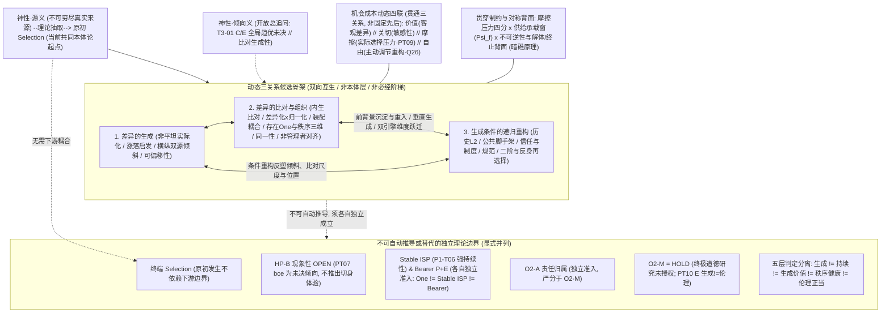

# `R3` 全骨架总收口：全局减法五份精炼视图与 `R4` 重构地图（`2026-11-25`）

> **治理定位（`canonical: false`）：** 本文为五阶段重构（[`SRT_AUTHOR_DECISION_FIVE_STAGE_SRT_RECONSTRUCTION_2026-11-22.md`](../../01_Source_Intuition/SRT_AUTHOR_DECISION_FIVE_STAGE_SRT_RECONSTRUCTION_2026-11-22.md)）中 **`R3` 理论骨架作者深度参与共创** 的总收口整合交付稿，统合 `R3-01..R3-08` 全部 `8 / 8` 已合并检查点（基线 `main@04887757c`）、`Step A`（`A1 / A2 / A3`）双向对账、三轮作者直觉校准与压测，以及全部跨模型精度校准（`B1-01..B1-09`、`P1-01..P1-06`）。
>
> **权威与证据边界声明：** 作者亲口原话、方向选项、未决倾向与 AI 候选推演的严格四级分界见 [`01_Source_Intuition/SRT_AUTHOR_ADJUDICATION_R3_CLOSEOUT_GLOBAL_SUBTRACTION_2026-11-25.md`](../../01_Source_Intuition/SRT_AUTHOR_ADJUDICATION_R3_CLOSEOUT_GLOBAL_SUBTRACTION_2026-11-25.md)。本文**未发现阻碍进入总收口与前置工程项 `ENG-01..ENG-04` 的重大方向性冲突**，但**不宣称**任何机制已获终局论证或实证支持，**不关闭**既有 `55` 项上游 `OPEN` 及总收口去重 `8` 项 `OPEN`（累计 `63` 项），**不修改**任何 canonical / Freeze-A 文件或 `_SRT_REVIEW_QUEUE.md`，**不提前启动** `R4 / R5`，**不解除**任何既有 `HOLD`（`O2-M`、`§10.1`、`§10.2`、`CN-2 E2`、`CN-3 toy`、`1B`、`DATA-ACCESS-0 = NO-GO`）、`07-23/24` 符号禁运与 `25` 条封存 `validation_holdout`。四大过渡引用规则在 `R4` 实作落地前全部继续生效。

---

## 0. 总收口核心进展摘要（从专题扩张转向全局减法与正向生成）

本轮总收口不再增设独立专题，而是完成三项结构跃升：
1. **本体—认识论定位协调（`T3-04 D` + `T3-01 C/E` 未决）**：区分不可被现有认知与对象化穷尽的**真实生成来源（神性·源义）**、该来源在跨尺度展开中的**客观内在趋优倾向（神性·倾向义，`T3-01 C / E` 保持开放未决）**，以及 SRT 当前切入该来源的最基础**理论抽取视角（原初 `Selection`）**——既保留强客观趋优研究方向，又把理论自反谦逊扎入起点（此为理论定位协调，不宣称已完成来源与倾向关系的最终论证）；
2. **动态三关系底座 + 机会成本动态四联 + 正向生成机制候选**：保留 **「差异的生成 ⇄ 差异的比对与组织 ⇄ 生成条件的递归重构」** 动态三关系（拒斥静态分科抽屉），嵌入**三条共享递归结构但职责各异的主轴命题**（方向 / 价值 / 存在）与**机会成本动态四联**（价值—关切—摩擦—自由，非固定先后顺序），重点补强**双引擎维度跃迁**（正交化化解垂直压制摩擦 + 无危机生成盈余跨界发现，非完备分类）、**四元协同共变**（不预设必然同步/同向）与**比对本身的生成性**（生成条件重构同时改写比对维度与比对尺度）；
3. **真减法与 `R4` 清障衔接**：在显式并列五项独立理论边界（`O2-A ≠ O2-M`）与五层判定分离的前提下，完成 `14` 项核心大词职责重审、八专题一致性与早期历史资产总处置、既有论文/实证诚实上限映射、`63` 项去重 `OPEN` 逐条分级，以及明确列出 `8` 类直接退出正典层旧结构的 **`R4` 重构地图**，下一步先推进前置工程项 **`ENG-01..ENG-04`**。

---

# 视图 ①：最小共同生成骨架与概念关系图

## 1.1 最小共同生成骨架（真减法核心，非演绎公理体系）

1. **来源、抽取与开放总追问的本体—认识论分工（`T3-04 D` / `T3-01 C/E`）**：
   - **真实生成来源（神性·源义）**：指向无法被现有认知与对象化描述完全穷尽的真实存在/生成来源（理性极限与实在来源，不设为独立于 `Selection` 的第二实体）；
   - **当前确立的共同本体论理论起点（原初 `Selection`）**：SRT 目前理解该来源的最基础**理论抽取视角**（非平坦、有限位置索引下的实际化非中立分化，不宣称已穷尽真实来源或独立证明全部解释充分性；保留原初层机会成本本体基础的开放研究，但不从实际化非等价直接推出可实现替代与机会损失）；
   - **客观全局趋优开放追问（神性·倾向义，`T3-01` 显式未决）**：作者保持 **`C`（存在共同客观度量基础的统一全局趋优原理）** 与 **`E`（存在统一的广义自由能/机会成本/其他全局极值原理）** 均未选定之强研究方向，严禁弱化为单纯位置性趋优或纯局部结构相容性；AI 候选 **`M1-D`（跨尺度机会成本—可达潜能对偶）** 与 `M1-A / M1-B / M1-C` 及**比对本身的生成性**视角并列留待后续检验。
2. **三个候选共同生成研究关系（双向互生，非三层本体实体、非必经线性阶梯）**：
   - **关系 ① · 差异的生成**：实际化非平坦分化、无预设目的涨落（随机游走启发）、横向共在 × 纵向留存双源倾斜与可偏移性；
   - **关系 ② · 差异的比对与组织**：内生比对、差异化 × 归一化跨尺度互促（局部归一化可催生高尺度新差异化；**绝不吞并**装配、耦合、功能分化、有效作用接口、`Proxy` 与 `Delegation` 的独立职责）、机会成本动态四联、对象/相对独立存在（`One`）、秩序（维系约束/方向偏向/生成重构三维）、同一性（实际生成连续性 × 位置比对条件）及高阶非管理者对齐（对齐 ≠ 同质化）；
   - **关系 ③ · 生成条件的递归重构**：历史持续效力（`L2`）、公共脚手架、信任分配与制度/规范约束（社会驻留不全部归入 `W_social`）、自由主动重构、二阶/反身再选择与组织重构；
   - **双向贯通枢纽（② ⇄ ③）**：**前背景转换与垂直生成**同时活跃于 ② 与 ③；前景对齐成果退入背景沉淀为无意识能力或公共脚手架，并在新价值比对或选择压力下重入前景。
3. **三条共享递归结构的主轴命题（各自理论职责不同，非完全对称或等价）**：
   - **方向**既是选择的结果，也是后续选择的条件；
   - **价值**既是比对的结果，也能反过来改变比对；
   - **存在**既是生成关系的组织结果，也能以相对独立的位置反向参与生成（组织连续性检验与机会后果变化检验独立并行，防止存在与价值循环互定义）。
4. **机会成本动态四联（贯通三关系核心性质，非固定先后因果链，不覆盖现行 canonical）**：
   - **价值（`PT05 C`）**：不同生成关系在生成机会成本上的客观差异（含关系客观可行性与认知抽取；保留 `R3-06` 发现性/生成性/递归性三类机会、三分析面与原初价值性质 `OPEN`，不窄化为新增机会）；
   - **关切（`PT06 C`）**：对生成机会成本的敏感性（与现行 `_SRT_D_VALUE_CANONICAL.md` 中的 `d` 为**待验证概念接口与候选关系**，不吞并构成深度 `Q1`、`Bearer P+E` 与 `T_dir`）；
   - **摩擦（`T3-02 D` + `PT09`）**：机会成本差异产生的**实际选择压力**（机会损失本身不自动构成摩擦，仅当该损失实际影响生成关系与后续选择时才构成摩擦；以多单元形成垂直结构后压制与机会损失为标志性核心机制，跨尺度贯通构建前碰撞张力 `07-19` 作为候选解释，不直接覆盖现行 `_SRT_PSI_F_CANONICAL.md`）；
   - **自由（`T3-03 C` + `Q26`）**：**`A-选项`（`T3-03 C`）**为基于价值与关切对生成机会成本结构的**主动调节与重构能力**（重新组织产生摩擦的生成关系）；**`A-原话`（`Q26`）**补充“自由对比多单元产生新的秩序和方向”；将其进一步外推为“无摩擦危机下的独立主动探索与盈余发现分支”属 **`M-推演`（AI 延伸候选，非 `T3-03 C` 作者直接选定的完整内容）**；自由不直接等同随机性、一般耦合或强二阶选择。
5. **正向生成机制候选与贯穿现实制约背面（`M-推演` 候选，非完备定律）**：
   - **双引擎维度跃迁（两种代表性生成路径，非完备分类）**：① **正交化跃迁**（垂直压制产生持续摩擦 → 经自由比对引入中介/分室/符号/时间解耦，将零和竞争正交化为弱干涉新维度）；② **无残差压力下的盈余跨界发现跃迁**（自动化/背景化降低维持机会成本 → 释放注意力/能量/耦合生成盈余 → 经关切敏感性与自由比对主动耦合跨界模块，在无危机下点亮新维度）；
   - **四元协同共变与比对生成性**：当生成条件重构时，价值度量、关切范围、摩擦来源与生成位置可各自变化亦可在特定跃迁中联动共变（不预设必然同步/同向），且重构不仅改变成本与可达空间，还改写**比对维度、比对尺度与何种差异能进入比对**；
   - **贯穿制约与对称背面（`A1`）**：实现条件内生于完整生成关系（不等于单一系统自行提供全部供给）；摩擦/压力侧四分（机会损失 / 现实结构压力 / 预测性压力 / 实际实现负担）配对供给与承载边界侧（`Ψ_f` 可支付窗，守分布式可支付性护栏）；发生不可逆性与**越阈解体/谱系终止对称背面**（解体 ≠ 谱系终止，终止含过载、主动结束与结构转化；暗礁原理：**某一位置的对象化与归一化判断不能穷尽其他生成位置及其实际相互作用**）。
6. **不可被共同生成关系自动推导或替代的独立理论边界（显式并列于外侧）**：
   - **独立边界 1 · 孤立终端 `Selection`**：原初发生不依赖下游耦合、留存或机会成本压力的边界；
   - **独立边界 2 · `HP-B` 现象性 `OPEN`**：意识现象性与切身体验尚未解决的理论问题（`PT07 bce` 属作者未决复合倾向，AI 将反身性暂作候选能力不等于作者否定反身性定义，且不推导感受质）；
   - **独立边界 3 · 强递归持续性 `Stable ISP / P1-T06` 与强承载 `Bearer (P+E)`（各自独立准入）**：废除旧线性硬件阶梯**不等于**删除强递归组织持续性研究；现行 [`Core_Law/SRT_Generative_Ontology_Spine.md §7`](../../Core_Law/SRT_Generative_Ontology_Spine.md#L326-L345) 与 `P1-T06` 所承载的历史再构成、视角/历史承载与持续可选择性条件独立保留，严格维持 **`One` 不自动推出 `Stable ISP`、`Stable ISP` 不自动推出 `Bearer (P+E)`（亦不自动推出 `subjecthood`）**，且外部归一化不可抹除 `Bearer (P+E)` 内部不可外包断链；
   - **独立边界 4 · `O2-A` 责任归属**：独立研究与准入条件（与 `O2-M` 严格分离）；
   - **独立边界 5 · `O2-M = HOLD`**：尚未获授权启动的终极道德研究（`PT10 E`：生成趋优与伦理趋优独立）；
   - **五层判定严格分离**：**本体实际生成 ≠ 组织持续 ≠ 位置性生成价值 ≠ 秩序健康性 ≠ 伦理正当性**。

---

## 1.2 概念与组织关系总图（双向互生，拒绝隐性阶梯）

---

## 1.3 七问减法总答与 `14` 项核心大词职责重审表

### （一）七问减法总答（遵循 `B1-08`：研究归属 ≠ 已完成理论推导）
1. **最少基本概念**：`1` 个不可穷尽来源与最基础理论抽取（神性·源义 / 原初 `Selection`）+ `3` 组动态生成关系（差异生成 / 比对与组织 / 条件递归重构）+ 机会成本四联接口（价值/关切/摩擦/自由）+ 贯穿现实约束背面（供给承载与不可逆解体/终止）+ 位置索引与暗礁不可穷尽性。
2. **获得骨架研究归属的概念**（具体生成关系、独立判据与形式化仍待分域研究，绝不宣称已从 `Selection` 演绎推出）：倾斜性、可偏移性、对象、存在（`One`）、秩序、同一性、时间、空间/四类距离、因果、机会空间、规则、脚手架、信任、权力接口、意识对齐。
3. **纯研究视角（非独立本体层）**：`L0/L1/L2`（同一现实三分析面）、`One` vs 「`R3-04 Bearer` 秩序视角候选」（存在与秩序双面）、结构 vs 方向（`PT04 C` 双视角）、物择/生物择/人择/神择（`Q02` 交叠反塑视角）、物理/生命/认知/社会四类组织条件接口。
4. **可反驳候选机制（`P2/P3/P4`）**：随机游走启发、多单元内生比对耦合握手、归一化三分与压缩/生成双门槛、双引擎维度跃迁、四元协同共变、`M1-A/B/C/D`、比对生成性、中膜缓冲（`B1-甲`）、微效价（`B3-b`）、$\rho / w_{\text{trust}}$ 分离、主动遗忘二式、`Q10–Q14` 神经假说。
5. **须建立独立判据以防循环**：原初 `Selection` 非循环判准；`One` 垂直再构成 vs 表面统计规律；存在（组织连续性）vs 价值（机会/后果变化）；生成型归一化双门槛；不健康固化与 `U5` 识别；`E` 正面充分建立；`T3-01 C/E` 可反驳边界。
6. **已降格、替代或登记退出的旧结构**：开关式“关闭—触发—重开”底层模型；旧线性硬件阶梯及 `2026-11-18 Q02` 四阶映射；对象性=可再选择旧孵化立场；封闭单标量 `o` 及 `d_canonical ≡ d_stakes ≤ D_eff`；`\hat G_\theta = 幽灵` 混同；耦合“紧/松/冻结”旧三分；自反机械两问计数。
7. **早期核心直觉保真度**：完整保真《从存在到秩序》主轴、`07-19` 阴阳山脊/动态平衡/`X5`/Y 层、`Q01–Q15`、`F_3223` 灵性参与转向及本轮三轮校准全部 `A-原话` 与核心方向，且零削减既有 `OPEN`。

### （二）`14` 项核心大词职责重审表（`R3` 减法定位 → 供 `R4` 重构地图输入，本轮不改 canonical）

| 核心概念 | 新骨架定位 | 减法处置与精确分工 | 不可跨越的独立边界 / `R4` 前保护 |
|---|---|---|---|
| **神性 / 神择** | **真实来源（源义）+ 客观趋优开放追问（倾向义）+ 整体视域（神择）** | 按 `T3-04 D` 作理论定位协调（非宣称论证完毕）；保留 `T3-01 C/E` 未决与工作三分（神性/神择/全局最小自由能）；废除“第四并行选择主体” | 严禁替作者选定 `C/E` 或弱化为纯局部涌现；`神择` 正典词表去留留待 `R4` 裁定 |
| **原初 `Selection`** | **当前最基础理论抽取起点**（`T3-04 D`） | 明确为 SRT 切入真实来源的最基础视角而非穷尽定义；去除菜单挑选项、必有主体、必留历史三误读 | 非循环判准仍 `OPEN`；兼容孤立终端 `Selection`；自身亦不享有 `U5` 理论豁免 |
| **`L0 / L1 / L2`** | **三分析视角**（非三层容器/仓库） | 严分人类描述所用 `L2` 脚手架与事件自身历史留存；模型级 `ρ` 非 `L2` 普遍原语 | 守住现行 `Spine §11` 规范 |
| **存在（`One`）与强持续性（`Stable ISP / P1-T06`）** | **派生组织态（关系 ②）+ 强递归持续性独立条件（关系 ②③ 接口）** | `One` 关注生成关系如何获得相对独立性（含内部归一化打开新接口与机会空间，与价值递归互生）；**`Stable ISP`（现行 owner：[`Spine §7`](../../Core_Law/SRT_Generative_Ontology_Spine.md#L326-L345) 与 `Core_21b` `P1-T06`）** 独立承担更强的递归组织持续性、历史再构成、视角/历史承载与持续可选择性职责，不因废除旧线性阶梯而被删除 | 须保留**垂直再构成路径**与独立组织连续性检验（防与价值循环）；严格维持 **`One` 不自动推出 `Stable ISP`、`Stable ISP` 不自动推出 `Bearer (P+E)` / `subjecthood`** |
| **秩序** | **独立核心概念（与存在一体双面，`B1-02`）** | 关注生成关系如何被组织、维持、发展与重构；保留 `R3-04` **维系约束 / 方向偏向 / 生成重构**三维 | 稳定性是持续性条件，**非**所有秩序成立必要条件；锁定亦属秩序（不健康固化） |
| **`Bearer`** | **双口径严格隔离**（`R3-04` 过渡规则） | 「`R3-04 Bearer` 秩序视角候选」作与 `One` 并行之秩序分析面；强承载 `Bearer (P+E)` 守住独立边界 3（独立于 `One` 与 `Stable ISP`） | `R4` 前绝不混用；`Stable ISP` 不自动推出 `Bearer (P+E)`；外部归一化不可抹除内部 `Bearer (P+E)` 不可外包断链 |
| **`Agency`** | **下游独立组织能力** | 撤出线性必经阶梯；承接改写自身及关系后续选择条件 | `Bearer ↔ Agency` 必要性方向 `OPEN`；独立对接 `O2-A` 归责边界 |
| **价值** | **机会成本动态四联之一（`PT05 C` + `B1-03/04`）** | 生成机会成本上的客观差异及位置比对抽取；保留发现性/生成性/递归性三类机会、三分析面与原初价值 `OPEN`（含维持条件、关闭有害方向、保护具备现实条件的机会） | 严格独立于秩序健康性与伦理正当性（`PT10 E`）；不与关切/`d` 混写 |
| **关切 / 现行 `d` / `D_stake` / `D_eff` / `T_dir`** | **严格分离的七项职责（`B1-04` + `P1-05`）** | ① **关切**：对生成机会成本的敏感性（`PT06 C`）；② **广义关切方向**：组织前背景、比对与生成方向；③ **现行 `d`**：`Bearer (P+E)` 不可逆风险敏感强度（与广义关切为**待验证概念接口**）；④ **`D_stake`**：赌注耦合方向谱参与率；⑤ **`D_eff`**：几何/信息论容量 proxy；⑥ **`T_dir`**：方向回读与重取向能力；⑦ **构成深度（`Q1`）**：暂缓 `q` 立符、自然语言完整保留 | 废止 `d_canonical ≡ d_stakes ≤ D_eff`；`07-23/24` 记号禁运继续生效；`Q22` 爱保留独立探索 |
| **摩擦 / `Ψ_f`** | **机会成本动态四联之一 + 贯穿制约（`T3-02 D` + `PT09`）** | 广义摩擦 = 机会成本差异产生的**实际选择压力**（以 `PT09` 垂直压制与机会损失为核心机制；跨尺度贯通构建前压力 `07-19` 作候选解释）；严分机会损失 / 现实结构压力 / 预测性压力 / 实现负担，并与 `R3-08` 摩擦四分（广义摩擦 / 非闭合压力 / `Ψ_f` / 主观痛苦）清晰对表 | 不直接覆盖现行 [`_SRT_PSI_F_CANONICAL.md`](../../_SRT_PSI_F_CANONICAL.md) 与 `Ψ_f → 0` 退化极限；能量/自由能/控制成本均为条件投影；守分布式可支付性护栏 |
| **自由** | **机会成本动态四联之一（`T3-03 C` + `Q26`）** | **`A-选项`（`T3-03 C`）**：基于价值与关切对生成机会成本结构的主动调节与摩擦重构能力；**`A-原话`（`Q26`）**：自由对比多单元产生新秩序与新方向；**`M-推演`（AI 延伸）**：外推至无摩擦危机下的盈余主动探索分支（非 `T3-03 C` 直接选定内容） | 不等同随机性、原初开放性（`O0`）、普通耦合或强二阶选择（`08-10 §9`）；组织层自由保持本体中性，伦理自主另由 `O2-A / O2-C` 约束 |
| **信任（`w_trust / W_social`）** | **关系 ③ 历史调用调节机制** | 适用模型下与非负痕迹 `ρ` 分离；明确**社会驻留效力**包含信任、制度、强制依赖等，不全部归入 `W_social` | 不拟人化泛化至物理尺度；`W_social` 暂不入符号表 |
| **时间 / 空间 / 距离** | **关系性度量接口（`PT08 D` + `A3`）** | 时间 = 生成秩序的一维（兼容 `R3-05` 横纵度量）；空间与四类距离（物理/作用/认知/生成）= 耦合可达与条件跨度接口 | 仅确立骨架归属，不宣称已完成物理时空推导；`R4` 收窄 `t_onto` 译名 |
| **阴阳 / `Ghost` / `\hat G_\theta`** | **保留未充分吸收负担的源直觉 + `\hat G_\theta` 正式解耦（`B1-07`）** | 阴阳与 Ghost 不作新增本体原语，但**不宣称核心理论负担已被充分吸收**（保留收敛/扩散共成动态结构、背景主动支撑、未尽关系与对象—摩擦互写等未尽负担）；`\hat G_\theta` 退回形成态参数载体，Ghost 五位职责分流 | 区分未尽关系 / 持续压力 / 对象化描述；`T-GH-01..07` 与 `NODE-GHOST-OPERATOR` 结项留 `R4` |

> **跨尺度五机制分工硬留存（`B1-06`）**：归入关系 ②③ 但绝不合并为“归一化”或“耦合”——**装配**（产生新整体组织与能力，未必归一化，形成新能力未必成 `One`）、**归一化**（认知表征 / 实际耦合 / 组织生成三分，压缩型 vs 生成型双门槛）、**有效作用接口**（整体相对独立参与他处生成）、**`Proxy`**（生成关系中介转承）、**`Delegation`**（具主体与规范条件的委托关系）。

---

# 视图 ②：八专题本体一致性核查、早期历史资产处置与 `R3-08` 溯源校正

## 2.1 `R3-01..R3-08` 八专题本体一致性与真实张力核查表

**核查总判定**：八个已合并检查点与总收口骨架之间**未发现阻碍进入 `ENG-01..ENG-04` 的重大方向性冲突**；本轮明确登记 **2 处需带入 `R4 / R5` 正面处理的真实张力** 与 **1 处理论定位协调**：
- **真实张力 1**：`T3-01`（`C` 统一全局趋优原理 / `E` 统一全局极值原理，未决）与 [`Core/SRT_OPEN_TENSIONS.md §17 C-A`](../../Core/SRT_OPEN_TENSIONS.md#L832-L852)（撤回宇宙级评价最优，仅在具名有限模型保留技术全局最优）之间的范围张力 → 留待 `R4` 明确区分“宇宙道德/评价最优（继续撤回，合 `PT10 E`）”与“非道德跨尺度全局生成趋优假说（保留开放）”，并在 `R5` 检验；
- **真实张力 2**：`PT09 / T3-02 D`（垂直结构压制与机会成本产生的实际选择压力）与 `2026-07-19`「构建前后压力都存在」及现行 [`_SRT_PSI_F_CANONICAL.md`](../../_SRT_PSI_F_CANONICAL.md) 之间的机制/术语边界 → 暂以跨尺度垂直嵌套作候选统一解释，不覆盖现行 `Ψ_f`，留 `R4/R5` 精切；
- **理论定位协调**：`T3-04 D` 在理论定位上协调了 `R3-01`（神性 = 不可知物自体来源）与 `R3-02 / PT02 C`（神性 = 母体趋向共同秩序倾向），具体论证与形式关系继续开放。

| 专题 | 已合并检查点 | 新骨架主要归属 | 一致性核查与总收口反向精炼要点 |
|---|---|---|---|
| **`R3-01`** | [`SRT_R3_01...md`](SRT_R3_01_PRIMITIVE_SELECTION_PROVISIONAL_CONVERGENCE_2026-11-23.md) | 起点抽取 + 关系 ① + 边界 1 | 与 `T3-04 D` 高度呼应（原初 `Selection` 为理论抽取，守住物自体理性极限）；终端 `Selection` 列为独立边界 1；保留多维摩擦反相对主义防线。 |
| **`R3-02`** | [`SRT_R3_02...md`](SRT_R3_02_CROSS_SCALE_GENERATIVE_MATRIX_PROVISIONAL_CONVERGENCE_2026-11-24.md) | 贯穿 ①②③ + 总追问 | 四层判定升为五层判定分离（并入生成价值）；三阶撤回标准与双向循环不变；`OPEN #4` 衔接 `T3-01 C/E` 可反驳边界。 |
| **`R3-03`** | [`SRT_R3_03...md`](SRT_R3_03_INNER_GENERATIVE_PROCESS_PROVISIONAL_CONVERGENCE_2026-11-24.md) | 关系 ② + 边界 2 | 保留原初内在生成过程与 `#1140` 二审结论；融入 11:57 随机游走→价值对比→意识对齐直觉及 `PT07 bce` 组织候选；`HP-B` 保持独立边界与独立退出条件。 |
| **`R3-04`** | [`SRT_R3_04...md`](SRT_R3_04_ONE_BEARER_EXISTENCE_ORDER_PROVISIONAL_CONVERGENCE_2026-11-24.md) | 关系 ②⇄③ + 边界 3 | 废弃 `2026-11-18 Q02` 旧线性阶梯；单列秩序三维与 `PT04 C` 结构/方向双视角；暗礁原理去除主客观二分；严守 `Bearer` 双语义过渡规则。 |
| **`R3-05`** | [`SRT_R3_05...md`](SRT_R3_05_TIME_HISTORY_TRUST_ORDER_PROVISIONAL_CONVERGENCE_2026-11-24.md) | 关系 ③ + 贯穿背面 | 对齐 `PT08 D` 时间定位；横纵双源倾斜与空间/四类距离/因果归口兼容；适用模型 `ρ ≥ 0 / Δw_trust / W_social` 分离完好，社会驻留不全归 `W_social`。 |
| **`R3-06`** | [`SRT_R3_06...md`](SRT_R3_06_CONCERN_VALUE_CONSTITUTIVE_DEPTH_PROVISIONAL_CONVERGENCE_2026-11-24.md) | 关系 ②（价值/关切） | 融入 `PT05 C`（客观机会成本差异）与 `PT06 C`（机会成本敏感性），保留三类机会、三分析面、原初价值 `OPEN`、存在↔价值独立双判据及 `d / D_stake / D_eff` 数学清算；严守 `P1-05`（现行 `d` 仅作待验证接口）。 |
| **`R3-07`** | [`SRT_R3_07...md`](SRT_R3_07_NORMATIVITY_ETHICS_ACCOUNTABILITY_PROVISIONAL_CONVERGENCE_2026-11-24.md) | 关系 ③ + 边界 4/5 | `PT10 E` 强化生成趋优 ≠ 伦理正当；`O2-A` 与 `O2-M = HOLD` 显式分离；对齐 ≠ 同质化呼应多重垂直参与；三套 `AI / S` 全称隔离完好。 |
| **`R3-08`** | [`SRT_R3_08...md`](SRT_R3_08_SECOND_ORDER_SELECTION_GHOST_CPSI_PROVISIONAL_CONVERGENCE_2026-11-25.md) | 关系 ②⇄③ + 贯穿约束 | `07-19` Y 层由 `A3-1` 落位；保留跨尺度五机制、强二阶选择三条件、五类变化刻度与耦合六维作关系 ③ 研究附表；`U5 ≠ U6`、`NODE-GHOST-OPERATOR` 结项计划、`§18 CΨ` 及 `B1-09` 时间校正完好。 |

---

## 2.2 早期历史资产总处置表（含 `HCLR01` 与本轮三轮校准源包）

| 历史资产 | 处置状态 | 精确去向与防漂移说明 |
|---|---|---|
| **`Q01`**（物自体—物理表象—心理价值双平行抽取） | **已吸收 + 留待 `R4`** | 入 `R3-01 / 03` 并与 `T3-04 D` 呼应；`Spine / L0 / O-Phil-11` 精切表述留 `R4`。 |
| **`Q02`**（物择 / 生物择 / 人择 / 神择） | **反向修正 + 留待 `R4`** | **废弃** `2026-11-18` 旧线性硬件阶梯，改为交叠反塑研究视角；暂留“神择”整体视域候选位，正典去留留 `R4`。 |
| **`Q03`**（`存在标识 × 域标识` & 双/三层动态膜） | **已吸收 + 反向修正** | 乘积限缩至弱耦合近似可分，深层确立存在与域双向互构；双/三层膜（中膜 `B1-甲`）守 `P2/P3` 启发位。 |
| **`Q04`**（双重时间起源 $\tau_{\text{ontic}} / t_{\text{exp}}$） | **已吸收 + 留待 `R4/R5`** | 并入 `R3-05` 七项时间接口与 `PT08 D`；`t_onto` 译名收窄留 `R4`，经验检验留 `R5`。 |
| **`Q05`**（广义意识/量子场早期表述） | **已被后续裁决取代（词表重型）** | 严格去泛心化，重型为原初 `Selection` 非平坦/内在生成过程与前对象取向。 |
| **`Q06`**（被链接/信任存在强度 vs 瞬时 Selection） | **已吸收** | 确立三维度并行非阶梯：实际发生（`S0`）/ 组织驻留（一般 `L2`）/ 社会驻留（含信任 `W_social`、制度与强制依赖）。 |
| **`Q07`**（`F_4337` 羞耻/利他下行约束） | **部分吸收 + 机制被 `2B` 取代** | 下行秩序约束入 `R3-07 O1 / P3`；人类能动层羞耻机制已由 `2026-11-22 2B` 取代，`3B` 留作 `O2-C` 非词典优先审查倾斜。 |
| **`Q08` / `Q09`**（预测-意愿三冲突 + 信任分配） | **已吸收 + 留待 `R4/R5`** | `Q08` 经 `X1` 校准为非必要冲突位点；`Q09` 入 `R3-05` 适用模型；神经实现与竞争对比留 `R5`。 |
| **`Q10–Q13`**（神经胶质/双免疫/单胺/左右脑与间性） | **留待 `R5`（骨架内核已吸收）** | `Q13` 间性核心负担由 `R3-08` 耦合与维度生成承接、短程过度收敛易碎性已吸收；神经/免疫/单胺具体机理归 `P3/P4 H-*` 留 `R5`（严守 `DATA-ACCESS-0 = NO-GO`）。 |
| **`Q14–Q15`**（路径记忆/主动遗忘/`Beacon`/语言数学标尺/LLM） | **已吸收 + 留待 `R4/R5`** | `Q14` 入 `R3-05/08`（`Beacon` 仅作工作标签）；`Q15` 入公共脚手架；AI 清理入 `ENG-03 / R4`。 |
| **`HCLR01`（[`SRT_History_Conditioned_Lie_Reachability_Bridge_v0_1.md`](../../03_Bridges/SRT_History_Conditioned_Lie_Reachability_Bridge_v0_1.md)）（`B1-06`）** | **显式独立保留 + 留待 `R5`** | 严守三层分离：**`HEF-3`**（历史改路径权重/代价，已有受限 tiny-MDP 证据）/ **`HEF-4`**（历史改生成元/组合结构，待验证假说）/ **反身再选择**（选择组织自身重入比对，独立理论问题）；连同 `R3-08` 强二阶选择三条件、五类变化刻度与耦合六维归为关系 ③ 研究附表。 |
| **`2026-07-12`** 跨尺度涌现与代理留痕 | **已吸收 + 反向修正** | 调整为多已成体装配路径之一（非一切 `One` 唯一前提）；保留跨尺度五机制独立分工（装配/归一化/接口/`Proxy`/`Delegation`）。 |
| **`2026-07-19` Ghost 两卡 + `07-27` `U5` 校正 + `08-10` Simondon 卡** | **保留未尽负担 + 留待 `R4`** | 持续动态平衡、`X5` 互写、Y 层同一性、`08-10 §9` 及五位职责分流已入骨架，**但不提前宣称阴阳与 Ghost 全部理论负担已被充分吸收**（`B1-07`）；严守 `U5 ≠ U6` 过渡规则；`NODE-GHOST-OPERATOR` 结项留 `R4 / ENG-02`。 |
| **`F_3223`“去选择” & `§18 CΨ` 灵性摩擦** | **已吸收方向 + 留待 `R4`** | 三义分流（排除义 ③）与灵性参与转向已确立；完整私密原笔记待核验，灵性域全量重审与 `RQ-2026-08-A05` 结项留 `R4`。 |
| **`2026-07-23/24/25` `d/q/o` 材料 & `RQ-2026-08-A02`** | **已吸收新口径 + 旧记号留 `R4`** | 新口径已入骨架；旧撞车符号禁运持续生效，实际清理与队列结项留 `R4`。 |
| **`Sync_Bridge` + 孵化稿两份** | **局部吸收 / 旧立场取代** | 给定感去病理化、遮蔽四分、`B3-a` 五去向、自反三问（废机械计数）、AI 三型已吸收；[`_SRT_OBJECTHOOD_AS_RESELECTABILITY_META_STANDARD.md`](../../90_Backstage/Incubation/_SRT_OBJECTHOOD_AS_RESELECTABILITY_META_STANDARD.md) 旧立场已废除；[`_SRT_DISTRIBUTIONAL_PAYABILITY_CANDIDATE_SEED.md`](../../90_Backstage/Incubation/_SRT_DISTRIBUTIONAL_PAYABILITY_CANDIDATE_SEED.md) 吸收为反伪装追问护栏、三技术缺口留 `R5`。 |
| **旧 `Seven Theses` & 《从存在到秩序》26Q 书稿** | **历史接口保留 / 书稿不静默改写** | `Seven Theses` 维持 `superseded_as_active_constitution`；书稿主线（[`BOOK_CURRENT_STATUS.md`](../../01_Source_Intuition/BOOK/BOOK_CURRENT_STATUS.md) `Drafts_26Q/` 五幕主线）保留为源直觉库。 |
| **`PR #1140` / `PR #1129` / `25` 条封存 `validation_holdout`** | **分流保留（不混并、不拆封）** | `#1140` 补二审指针与 `#1129` NME 四步单审归 `ENG-04`；`25` 条留出集严密封存至 `R5`。 |
| **2026-11-25 三轮作者直觉校准与压测记录** | **已分层归档（含缺失标定）** | 见 [`SRT_AUTHOR_ADJUDICATION_R3_CLOSEOUT_GLOBAL_SUBTRACTION_2026-11-25.md`](../../01_Source_Intuition/SRT_AUTHOR_ADJUDICATION_R3_CLOSEOUT_GLOBAL_SUBTRACTION_2026-11-25.md)；严格四分 `A-原话 / A-选项 / A-倾向 / M-推演`，标明初轮 `Q01–Q13` 未选项与 `Q14` 完整原题缺失（不补造），`Q22` 爱与 `PT07 bce` 留作独立探索。 |

## 2.3 非阻塞溯源校正记录（`B1-09`：`R3-08` 确认时间口径）

已在作者溯源文档 [`§3`](../../01_Source_Intuition/SRT_AUTHOR_ADJUDICATION_R3_CLOSEOUT_GLOBAL_SUBTRACTION_2026-11-25.md#L128-L136) 完成精确区分：`10:33:50+08:00` 仅对应 `P2-01..P2-06` 作者直接确认；`P2-07..P2-09` 记为 `10:44:03`（`7a4e42738`）后续评审追加、随 PR `#1153`（`04887757c`，`10:52:00/01`）合并归档的精度校准，不反向扩大原确认范围，无需重开 `R3-08`。

---

# 视图 ③：既有论文与实证轨双向映射（严守 `reconstruction carve-out` 与诚实证据上限）

> **铁律**：绝不将新骨架对既有论文或模型的解释性兼容，升级为“已获实证支持”；绝不静默改写已发表/已投稿稿件；绝不解除任何既有 `HOLD / NO-GO`。

| 论文 / 实证轨 | 真实状态与原始证据来源 | 在 `R3` 新骨架中的兼容接口 | 反向约束与诚实证据上限（禁止越界） |
|---|---|---|---|
| **1. *Frontiers in Neuroscience*（Zhang 2026）** | **已发表**（2026-08-06，DOI `10.3389/fnins.2026.1837760`，Hypothesis & Theory，5 项可检验假说，无新实验数据）；后收敛见 [`POST_PUBLICATION_CONVERGENCE_2026-08-18.md`](../../papers/ontological_friction/POST_PUBLICATION_CONVERGENCE_2026-08-18.md) | 对应 `A1` 实现负担与承载窗（`Ψ_f / P_sel`）的执行控制域代理；五层拆解（`R_struct ≠ A_eff ≠ Ψ_f(i→j\|admitted) ≠ C_effective ≠ reselectability`）界定何种未实现方向进入当下竞争。 | 受 `reconstruction carve-out` 保护；无新实证数据；`attractor ≠ L2`、`NCT energy ≠ Ψ_f`；**不得**将 `T3-02 D / PT09` 垂直压制摩擦或压力四分倒写为该文已验证结论。 |
| **2. *Adaptive Behavior* 投稿稿（CSC v18 → v19 重构决策）** | **已投稿（v18）+ 重构决策（v19）**，见 [`CostlySelectiveClosure_v19_E1_E4_RECONSTRUCTION_DECISION.md`](../../papers/CostlySelectiveClosure_v19_E1_E4_RECONSTRUCTION_DECISION.md)：`E1` 发现性强效应（未预注册）；`E2` 未支持；`E3` 反向；`E4` 预注册**小幅正向**（`+0.030`，未达 `+0.10` 强支持门） | 对应 `A1-4` 解体与终止背面及 `Bearer (P+E)` 不可外包后果范围的受限多智能体试验床；后果六描述符对接 `A1-4 / A3-1`。 | **绝非** CSC、生命定义或全 SRT 证明；`E4` 不解释 `E1` 全幅；智能体非生命体；`E2/E3` 负/反向结果完整保留。 |
| **3. History-Dependent Reachability（`W_sel` / tiny-MDP）** | **构造性计算理论/方法稿**，见 [`PAPER_CHARTER.md`](../../papers/history_dependent_reachability/PAPER_CHARTER.md)：Phase 1 构造分离；Phase 2b `\|PE\|` **NO-GO**；Phase 2c 可行性；tiny-MDP 确证 `W_sel` 可达性（`HEF-3`）；FMNIST `0/5` **NO-GO** | 对应 `R3-05` 历史持续效力（`L2`）与 `HCLR01 HEF-3` 的受限设计模型存在性证明与识别协议。 | **不是**自然系统实证或 SRT 本体证明；不涉 `Ψ_f`、意识、价值或生命；仅覆盖 `HEF-3`，**不证明** `HEF-4` 或反身再选择；Phase 2b 与 FMNIST NO-GO 永久保留。 |
| **4. 前对象认知生成取向（`CN-2`）+ 音乐伴行 + `HP-B` 冻结包** | 历史 `CURRENT NEXT` 转为有条件保留资产（[`STATUS.md`](../../STATUS.md#L1175-L1182)）：`Task Family A` 仅纸面优先排序，**`E2` 预测增益未建立**，`E3 / E4` 未建立；`CN-3 / toy = HOLD`；`HP-B` 冻结于非 canonical `P3`；音乐 `A11 §15.5 HOLD` | 对应 `R3-03` 认知垂直展开、`R3-06` 广义关切方向、`A2` 意识对齐及 `PT07 bce` 的中立认知科学对照接口。 | 中立认知科学先行、允许 SRT 产出零增量；不得借 `R3` 收口解冻 `CN-2 E2`、`CN-3 toy` 或 `HP-B` 冻结包。 |
| **5. `GRG` 跨领域融合轨** | **已执行 `§8.1` 止损并暂停收缩**：`Case 1 (FRR)` + `Case 2 (推荐)` 均落 `SOURCE_OWNED_DECOMPOSITION_NO_GRG_GAIN`；`BCTB T2 = HOLD`；禁另开第三融合域 | 对应 `R3-02` 三阶撤回标准与局部无增量治理的历史反例库。 | 严禁把 `R3` 最小骨架当成重启 `GRG` 融合轨或解除 `§10.2` 广域综合 `HOLD` 的通行证。 |
| **6. 神经科学试点 / 认识论试点 / `PR #1129`（NME）** | **`DATA-ACCESS-0 = NO-GO`**（不启神经深井）；`#1129` `Draft` + CI 失败转 `ENG-04` 四步单审；`§10.1` 第三主深井 **`HOLD`** | 对应 `Q10–Q14` 神经/胶质/免疫/单胺 `H-*` 比较假说与下行约束接口。 | 不将试点局限泛化为整套 SRT 判决，亦不将 `#1129` `χ_payable` 代理偷换为意识证明或 `Ψ_f = 代谢消耗`。 |
| **7. `25` 条封存 `validation_holdout`** | **严格密封未拆** | 留作 `R5` 样本外盲测独立验证集。 | `R3 / R4` 全程严禁拆封或用于反向调参。 |

---

# 视图 ④：去重后累计 `55 + 8 = 63` 项 `OPEN` 逐条可追溯分级表

> **去重与零漏计数核验（遵循 `P1-06`）**：上游 `R3-01`（`6`）+ `R3-02..R3-08`（`7 × 7 = 49`）= **`55` 项**原编号零删减；总收口经严格去重仅保留 **`8` 项**（`R3-CL-O1..O8`——原拟议重复项已分别并入 `R3-CL-O1 / O4`，`PT07 bce` 与 `HP-B` 严守既有 `R3-03-O1 / O3` 独立退出条件，绝不与双引擎机制混绑），总计 **`10`（分级 A）+ `37`（分级 B）+ `16`（分级 C）= `63` 项**。另同步保留 [`Core/SRT_OPEN_TENSIONS.md`](../../Core/SRT_OPEN_TENSIONS.md) 现存未封口项及 **`O2-M = HOLD`**。

### 分级 A：`R4` 规范落地、定义对账与清理结项项（共 `10` 项）

| 编号 | 来源 | 核心问题摘要 | 当前状态 | 目标 `R4` Owner / 工程项 | 推进/结项条件 | 优先级 |
|---|---|---|---|---|---|---|
| `R3-01-O6` | `R3-01 §2.6` | 跨位置统一性边界及 `O-Phil-11 / Before_Objects §5.4` 与 `Q01` 物自体双平行抽取协调（衔接 `T3-04 D`） | `OPEN` | `Spine` / `L0_Metaphysics` / `Philosophy` | `R4` 确立不滑向二元论或唯心论的精切表述 | **P0** |
| `R3-03-O6` | `R3-03 §2.6` | `Core_Law` 既有因果闭合措辞复审（剥离物理本体穷尽性、保留合法物理闭合边界） | `OPEN` | `Spine` / `Core_Law` 各 owner | `R4` 逐 owner 核查清理 | **P1** |
| `R3-04-O3` | `R3-04 §2.3` | `One / Bearer` 双面统一在 `R4` 规范落点（协调 `Spine §8` `One+P+E->Bearer`）及 `P/E` 正面判据接口 | `OPEN` | `Spine §8` / `One_Formation` / `Individuation` | `R4` 定最终术语分工；正面 `E` 充分性续归分级 B | **P0** |
| `R3-05-O6` | `R3-05 §2.6` | `t_onto` 符号表译名收窄、`Core_12b` 非负 `ρ` 与 `w_trust` 分离注记、`B3-a` 五去向与主动遗忘二式落盘 | `OPEN` | `_SRT_SYMBOL_TABLE.md` / `Core_12b` / `Causality_Time` | `R4` 实作落地并通过校验 | **P0** |
| `R3-06-O4` | `R3-06 §2.4` | 广义关切组织机制与 `R4` 重构 `d / D_stake / D_eff` 数学错式（含 `PT06 C` 待验证概念接口，`P1-05`） | `OPEN` | `_SRT_D_VALUE_CANONICAL.md` / 符号表 | `R4` 退出 `d_canonical ≡ d_stakes ≤ D_eff`；包含关系证明转 `R5` | **P0** |
| `R3-06-O6` | `R3-06 §2.6` | `N2` 适用边界、`C1-c` 多维客观性落盘及 `07-23/24` 旧撞车符号清理与 `RQ-2026-08-A02` 结项 | `OPEN` | 符号表 / `OPEN_TENSIONS §9` / `_SRT_REVIEW_QUEUE.md` | `R4` 清理并更新队列；弱操作化审计转 `R5` | **P0** |
| `R3-08-O5` | `R3-08 §2.5` | Ghost `T-GH-01..07` 保留开放下 `NODE-GHOST-OPERATOR` 的 `EA-1`、`EA-2..EA-5`（含 `Spine` 与 `EA-4`）及 `Axis B` 整体结项 | `OPEN` | `Spine` / `Reference_Dynamics` / `Core_21` / 符号表 / `ENG-02` | `R4` 实作 + 新会话行为验收（`T-GH` 续归分级 B） | **P0** |
| `R3-08-O6` | `R3-08 §2.6` | `F_3223` 完整私密原笔记核验、`§18 CΨ / RQ-2026-08-A05` 灵性域全量重审，及分布式可支付性三技术缺口 | `OPEN` | `Spirituality/*` / `OPEN_TENSIONS §18` / `_SRT_REVIEW_QUEUE.md` | `R4` 核验原笔记并完成全量灵性修订（三技术缺口转 `R5`） | **P0** |
| `R3-03-O7` | `R3-03 §2.7` | 神性双面表述协调（`#1140` 无脚手架参与 vs `R3-02` 跨尺度倾向，衔接 `T3-04 D` 理论定位协调） | `OPEN` | `Spine` / `Spirituality` / `ENG-04 (#1140)` | `R4` 明确双视角规范接口；深层统一论证续留分级 B | **P1** |
| `R3-02-O6` | `R3-02 §2.6` | 物理学自然律在“原初生成属性 / 条件性组织规律 / 历史性硬化规则”三分中的归属边界 | `OPEN` | `Spine` / `Physics/SRT_Physics_Claim_Status.md` | `R4` 固定边界说明；实质物理归属续留分级 B | **P2** |

### 分级 B：长期本体论、机制与独立判据开放项（共 `37` 项 = 上游 `31` + 总收口 `6`）

| 编号 | 来源 | 核心问题摘要 | 当前状态 | 后续主责接口 | 解决/推进条件 | 优先级 |
|---|---|---|---|---|---|---|
| `R3-01-O1` | `R3-01 §2.1` | 原初 `Selection` 非循环判准（不回填 `L2` 留存下区分真实实际化 vs 描述/模型变化） | `OPEN` | `Spine §2.1` / `Core_21` | 提出非循环结构判准或域反例族 | **P0** |
| `R3-01-O2` | `R3-01 §2.2` | 原初最低非平坦性与 `O0/S0` 共原初分面精确关系、“非自我抹除”分层定位（含原初机会成本基底研究，`P1-02`） | `OPEN` | `Spine` / `L0_Metaphysics` | 区分实际分化非等价、互斥可能性与可实现替代 | **P1** |
| `R3-01-O3` | `R3-01 §2.3` | 持续组织生成门槛（单次垂直显现跨向持续 `One` 的结构条件） | `OPEN` | `One_Formation` | 独立于事后存续的非循环成体条件 | **P0** |
| `R3-01-O4` | `R3-01 §2.4` | 跨尺度五机制（装配、`Gate / A0-Q10`、`Proxy`、归一化、内生规则）统一程度与独立分工边界 | `OPEN` | `Spine` / `Core_14` | 检验共同结构 vs 分域机制 | **P1** |
| `R3-01-O5` | `R3-01 §2.5` | 多维摩擦与知识有效性、规范正当性及动态边界下统计力学粗粒化熵之对应 | `OPEN` | `_SRT_PSI_F_CANONICAL` / `Physics` | 明确统计力学边界（不改热二律） | **P1** |
| `R3-02-O1` | `R3-02 §2.1` | 原初基础属性候选（原 6 项）的最小性、归并与跨维度严格成立程度 | `OPEN` | `Spine` | 结合三关系底座压测最小属性集 | **P1** |
| `R3-02-O2` | `R3-02 §2.2` | 内生比对底层判据及评价/比对尺度本身能否在比对中递归生成 | `OPEN` | `Spine` / `One_Formation` | 构造无外部裁判的比对与新尺度生成模型 | **P0** |
| `R3-02-O3` | `R3-02 §2.3` | 生成性退隐与相容性的非循环判据（独立于事后存活/成功） | `OPEN` | `Spine` / `Collective_Selection` | 区分赋能退隐与寄生/锁定 | **P1** |
| `R3-02-O4` | `R3-02 §2.4` | 神性内在倾向的可约束性与可反驳条件（防沦为全解释标签；交叉索引 `R3-CL-O4`） | `OPEN` | `Spine` / `OPEN_TENSIONS` | 结合 `A2-2` 四反例边界与 `T3-01 C/E` 构造检验 | **P0** |
| `R3-02-O5` | `R3-02 §2.5` | 跨具身位本体分叉（独立位置耦合协调 vs 同一生成关系非独立侧面） | `OPEN` | `Spine` / `One_Formation` | 结合 `R3-03/04` 兼容框架检验 | **P2** |
| `R3-02-O7` | `R3-02 §2.7` | 垂直结构与关切 `d` 递归生成机制及 `Bearer ↔ Concern/Agency/Consciousness` 必要性方向 | `OPEN` | `Spine §8, §13` / `_SRT_D_VALUE_CANONICAL` | 结合 `R3-04-O5` 检验非 `P+E` 系统 | **P1** |
| `R3-03-O1` | `R3-03 §2.1` | `HP-B` 与现象性成立条件（`B_s -> B_p ?`、切身在场与 `qualia`；承接 `PT07 bce` 独立退出边界，`P1-06`） | `OPEN` | `HardProblem_Epistemology` / 冻结 `HP-B` 包 | 独立现象性机制与 `P4` 匹配对照（绝不与双引擎混绑） | **P0** |
| `R3-03-O2` | `R3-03 §2.2` | Kim 因果排除问题最后硬刺（第一人称体验作为体验本身是否具非冗余因果效力） | `OPEN` | `HardProblem_Epistemology` | 哲学与实证双向判别 | **P1** |
| `R3-03-O3` | `R3-03 §2.3` | 意识区别于无意识层级认知的充要判据（含 `PT07 bce` 组织候选对无意识复杂协调的判别） | `OPEN` | `Consciousness_Conditions` / `R3-03` 接口 | 构造非循环判别条件 | **P0** |
| `R3-03-O4` | `R3-03 §2.4` | “内在生成过程”正面非换名边界及是否包含前现象性质（与 `2026-09-06` 残余哲学张力） | `OPEN` | `Spine` / `HardProblem_Epistemology` | 区分物理内生动力学与内在生成 | **P1** |
| `R3-03-O5` | `R3-03 §2.5` | 跨位置相对独立性的形成、保持与重划条件 | `OPEN` | `One_Formation` | 与 `R3-CL-O2 / O3` 联合推进 | **P1** |
| `R3-04-O1` | `R3-04 §2.1` | 物理三态（束缚平衡 / 耗散动态 / 内生互维）各自跨过 `One` 维持门槛的具体结构条件 | `OPEN` | `One_Formation` / `Physics` | 明确态 I / 态 II 门槛判据 | **P1** |
| `R3-04-O2` | `R3-04 §2.2` | 秩序范围与“健康生成重构秩序 vs 不健康选择固化”的非循环判据 | `OPEN` | `One_Formation` / `Occlusion_Dynamics` | 独立于事后存活的可检固化判据 | **P0** |
| `R3-04-O4` | `R3-04 §2.4` | `ε_pg / κ_0` 向更强形成态非对称性的精确继承门 | `OPEN` | `Core_21` / `Irreversibility` / `Claim_Ladder §0A` | 明确 Gate 0 与形成态继承定理 | **P1** |
| `R3-04-O5` | `R3-04 §2.5` | `Bearer (P+E)` 与 `Agency / Consciousness / Concern / 伤害与苦难` 的必要性方向（含非 `P+E` 能动/AI） | `OPEN` | `Spine §8, §13` / `Agency_Subjecthood_v0_2` / `Suffering` | 逐分支检验必要性而非预设单链 | **P0** |
| `R3-05-O1` | `R3-05 §2.1` | 原初 `Selection` 计数单位、普遍物理时钟与热力学/宇宙学时间箭头导出 | `OPEN` | `Core_21b` / `Causality_Time` / `Physics` | 严格偏序条件与物理时钟构造 | **P1** |
| `R3-05-O2` | `R3-05 §2.2` | 时间参照比对与原初内生比对机制统一性，及时间脚手架反向参与新秩序生成条件 | `OPEN` | `Causality_Time` / `Spine` | 检验两类比对同构或分化 | **P2** |
| `R3-05-O3` | `R3-05 §2.3` | 空间、时间与价值等关系属性的共同生成来源（不替代相对论时空） | `OPEN` | `Spine` / `Causality_Time` | 与 `R3-CL-O7` 联合保持轻量接口 | **P2** |
| `R3-06-O1` | `R3-06 §2.1` | 排除先验道德与先验评判标准后，原初生成关系差异是否含任何原初价值性质 | `OPEN` | `Spine §10` / `_SRT_D_VALUE_CANONICAL` | 明确原初差异与构成价值界线 | **P1** |
| `R3-06-O2` | `R3-06 §2.2` | `F1+` 局部向整体收敛动力学、自由能最小化适用边界及与 `C-A / B-A` 历史张力最终收口（交叉索引 `R3-CL-O4`） | `OPEN` | `OPEN_TENSIONS §16–§17` / `Spine` | 结合 `T3-01 C/E` 在 `R4/R5` 明确界分与检验 | **P1** |
| `R3-06-O3` | `R3-06 §2.3` | 生成价值、秩序健康性与破坏性扩张的非循环区分（严守不偷渡 `O2-M`） | `OPEN` | `Occlusion_Dynamics` / `Ethics_PH_SS_Guardrails` | 结合六维诊断与六失配建立判据 | **P0** |
| `R3-07-O1` | `R3-07 §2.1` | 规范性的充分发生条件（排除“参照独立性 + 偏离反馈”充当充分定义后） | `OPEN` | `Spine §10` / `Ethics_PH_SS_Guardrails` | 确立判断依据地位的组织条件 | **P0** |
| `R3-07-O2` | `R3-07 §2.2` | 跨尺度参照独立化维持/改写机制，及多重垂直参与何时促成创新 vs 引发角色撕裂 | `OPEN` | `Collective_Selection` / `Social_Cognition` | 建立条件性组织诊断框架 | **P1** |
| `R3-07-O5` | `R3-07 §2.5` | `3B` 跨尺度不可逆冲突与闭合边界（大尺度基底损失 vs 个体构成底线、无声受影响者，守 `O2-M = HOLD`） | `OPEN` | `Ethics_PH_SS_Guardrails` / `OPEN_TENSIONS §9` | 制定非词典式优先审查操作边界 | **P1** |
| `R3-07-O6` | `R3-07 §2.6` | `O2-A` 精确充分条件（`Bearer / Agency / theta_acc -> S6`）及人机三型中介归责切分 | `OPEN` | `Agency_Subjecthood_v0_2` / `Subjecthood_Threshold_Interface` / `AI` | 明确多主体归责边界（含 `AI S3/S4` 开放窗） | **P0** |
| `R3-08-O1` | `R3-08 §2.1` | 耦合共同生成与“间性”残余边界（单元/边界/协议共同生成、维度生成、对称破缺、未成整体新关系） | `OPEN` | `Spine` / `One_Formation` / `Core_14` | 深化 `(A,B)->(A',B',C)` 动力学条件 | **P1** |
| **`R3-CL-O2`** | `Step A-3` | 压缩型归一化向生成型归一化跃迁双门槛（内部耦合重构 / 跨位置条件化生效）的精确判据 | `OPEN` | `One_Formation` / `Spine` | 给出独立于事后成功的判别标准 | **P0** |
| **`R3-CL-O3`** | `Step A-3` | 存在（组织连续性）与价值（机会/后果变化）递归互生中的各自独立非循环判据 | `OPEN` | `One_Formation` / `_SRT_D_VALUE_CANONICAL` | 防止存在与价值循环互定义 | **P0** |
| **`R3-CL-O4`** | `Step A-2 / T3-01` | 神性双方面与 **`T3-01` `C`（统一全局趋优原理）vs `E`（统一全局极值原理）**未决抉择、`M1-D` 等候选在可变维度相空间下的共同度量与可反驳边界，及与 `OPEN_TENSIONS §17 C-A` 的 `R4` 条文界分（已去重吸收原拟 `O8`，交叉索引 `R3-02-O4 / R3-06-O2`） | `OPEN` | `Spine` / `OPEN_TENSIONS §17` | `R4` 厘清与 `C-A` 条文分工；`R5` 检验度量、循环与动态相空间三难题 | **P0** |
| **`R3-CL-O5`** | `Step A-3` | 持续变化中同一性（`07-19` Y 层：实际生成连续性 × 位置比对条件）及分支/合并精确判据 | `OPEN` | `One_Formation` / `Spine §13` / `Irreversibility` | 兼顾多对多谱系拓扑与内部 `E` 断链 | **P1** |
| **`R3-CL-O6`** | `Step A-3` | 物理/生命/认知/社会四类组织条件跃迁的充分性与非隐性阶梯边界 | `OPEN` | `Spine` / 跨域接口 | 检验各组织条件是否具独立充分性 | **P1** |
| **`R3-CL-O8`** | `T3-03 / Step B` | 共同研究入口（**内部设 5 项独立子问题与独立退出条件，可分别结项、不新增 OPEN 总数**，严与 `HP-B` 独立退出条件分离）：① **自由成立条件**：内生机会成本调节与认知位置/参照独立化的跨尺度必要性；② **自由与强二阶选择分界**：`T3-03 C / Q26` 与 `08-10 §9` 机制分界（交叉索引 `R3-08-O1 / R3-08-O2`）；③ **双引擎维度跃迁**：垂直压制正交化 vs 盈余发现及非完备边界的操作化新维度生成模型（交叉索引 `R3-02-O2 / R3-08-O2`）；④ **四元协同共变**：价值度量/关切范围/摩擦来源/生成位置各自独立变化与特定跃迁联动条件（交叉索引 `R3-06-O3 / R3-CL-O6`）；⑤ **比对尺度递归生成**：选择与条件重构如何改写后续比对维度与判断条件（交叉索引 `R3-02-O2 / R3-08-O1`） | `OPEN` | `Spine` / `One_Formation` / `Philosophy` | ① 给出无循环跨尺度自由判据；② 给出自由与强二阶选择可分离/重合边界；③ 在具体模型中跑通新维度生成并对比 Simondon / Kauffman / 装配理论；④ 给出区分独立变化与联动跃迁的判别案例；⑤ 给出“选择改写比对条件”的非同义反复最小机制（五项可各自独立退出） | **P0** |

### 分级 C：`R5` 竞争比较、操作化与实证检验项（共 `16` 项 = 上游 `14` + 总收口 `2`）

| 编号 | 来源 | 核心问题摘要 | 当前状态 | 强竞争者 / 检验载体 | 推进条件（严守发现域不得自证与三阶撤回） | 优先级 |
|---|---|---|---|---|---|---|
| `R3-04-O6` | `R3-04 §2.6` | 微效价（`2C`）相对 Core Affect / 躯体标记的不可替代残差检验 | `OPEN` | `_SRT_D_VALUE_CANONICAL §2a.5` | 无残差则按 Ⅱ 阶撤回 | **P2** |
| `R3-04-O7` | `R3-04 §2.7` | 个体化与秩序重构主轴相对 Simondon / 组织闭包 / 自创生 / MET / FEP 的非换名检验 | `OPEN` | 独立现象/新约束对比 | 发现域外新预测或新失配诊断 | **P1** |
| `R3-05-O4` | `R3-05 §2.4` | 低尺度非拟人“信任”机制，及“退出显现 / 退出调用 / 退出生成作用”分域实现 | `OPEN` | 记忆重巩固 / 非平衡记忆系统 | 分域设计双分离判别实验 | **P2** |
| `R3-05-O5` | `R3-05 §2.5` | 社会/集体层区分高 `ρ` 强制惯性与可修订信任权重 `W_social` 的操作化 | `OPEN` | 制度路径依赖 / `Collective_Selection` | 剥离产权、权力强制与信任变量 | **P1** |
| `R3-05-O7` | `R3-05 §2.7` | 时间脚手架与 `ρ / Δw_trust` / 主动遗忘相对 Rovelli / 因果集 / 3 级 HGF / 重巩固 / 制度经济学的非换名检验 | `OPEN` | `P-Q09-1` 等独立任务族 | 同目标比较，无残差则 Ⅰ 阶撤回 | **P1** |
| `R3-06-O5` | `R3-06 §2.5` | 构成深度 `q` 四项残差（事件跃迁 / 铭刻 vs 召回 / `N4` 退位 / 跨关系构成依赖深度）的机制与经验检验 | `OPEN` | `C_i` + 双测试 + `ρ` + `w_trust` | 决定 `R5` 是否需独立变量形式化 | **P1** |
| `R3-06-O7` | `R3-06 §2.7` | 价值/机会重构/构成深度/`N2` 相对期望效用 / 生物目的论 / 具身生成 / Damasio / 结构学习版主动推断 / 价值论的非换名检验 | `OPEN` | 含结构学习的最新竞争版本 | 聚焦维度/尺度/机会空间/组织关系重构 | **P0** |
| `R3-07-O3` | `R3-07 §2.3` | 协同共选五条件操作化，及 `Order_hat` 相对 `Empowerment` 等核的经验残差 | `OPEN` | `Collective_Selection` / `P-Q08-1` | 无残差则撤回 `Order_hat` 增量 | **P1** |
| `R3-07-O4` | `R3-07 §2.4` | `2B` 无羞耻冲突调节跨文化有效域，及 `W_social` 相对强制与路径粘性的实证分离 | `OPEN` | 社会认知 / 跨群体实证 | 检验非羞耻亲社会稳定机制 | **P2** |
| `R3-07-O7` | `R3-07 §2.7` | 规范/权力/社会发展四维相对制度主义 / Habermas / Foucault / 道德责任哲学 / AI 治理的非换名检验 | `OPEN` | 跨领域社会/治理比较 | 同目标检验结构约束增量 | **P1** |
| `R3-08-O2` | `R3-08 §2.2` | `HCLR01` `HEF-4` 经验可检条件、`08-10 §9` 强二阶选择三条件适用边界与广义机制重构分界 | `OPEN` | `HCLR01` / 计算模型 | 构造可证明改写生成元的判别设计 | **P0** |
| `R3-08-O3` | `R3-08 §2.3` | 认知三过程（历史复用 / 锚点重构 / 新比对能力生成）与洞察力的神经/计算区分指标 | `OPEN` | 元学习 / 结构学习 / 洞察研究 | 受 `DATA-ACCESS-0` 约束，先理论/计算界定 | **P1** |
| `R3-08-O4` | `R3-08 §2.4` | 持续动态平衡中滞回/结构势垒形成条件，及 `U5`（高频局部创新 × 核心组织豁免）跨尺度操作化诊断 | `OPEN` | 复杂自适应系统 / 组织案例 | 构造反伪装识别指标 | **P1** |
| `R3-08-O7` | `R3-08 §2.7` | 耦合/动态互写/灵性转向相对二阶控制论 / Simondon / 元认知 / 悬置无为传统 / 复杂系统相变的非换名检验 | `OPEN` | 五类强竞争理论基线 | 发现域外独立检验与三阶撤回 | **P1** |
| **`R3-CL-O1`** | `Step A-1 / T3-02` | 摩擦/压力四分与 **`PT09 / T3-02 D`** 垂直压制机制、构建前碰撞张力及 `_SRT_PSI_F_CANONICAL.md` 供给承载边界的跨尺度操作化界分与条件投影（已去重吸收原拟 `O9`，交叉索引 `R3-01-O5 / R3-08-O6`） | `OPEN` | 执行控制 / 组织模型 | 区分机会损失、实际选择压力与物理/代谢承载侧 | **P1** |
| **`R3-CL-O7`** | `Step A-3` | 空间、四类距离（物理/作用/认知/生成）、因果非对称依赖与五类跨时间传递接口的形式化与物理对接（交叉索引 `R3-05-O3`） | `OPEN` | 物理 / 演化 / 社会网络模型 | 不宣称替代相对论时空或达尔文方程 | **P2** |

---

# 视图 ⑤：`R4` Canonical Owner 真减法重构地图与 `ENG-01..ENG-04` 衔接序

> **执行铁律（遵守 `2026-09-24` 作者次序与 `R3` 减法标准）**：① 本收口归档合并后，先依次完成前置工程清障项 **`ENG-01..ENG-04`**，并**获得作者单独正式授权**后方可进入 `R4`；② 以**替换、合并、降级与退出**旧冲突结构为目标，绝不向旧 canonical 无限堆补丁；③ **Wave 顺序不等同于独立合并边界（跨 owner 原子语义一致性铁律）**：`Wave R4-1..R4-4` 是理论设计与实施先后顺序（`Spine` 先行 → 核心语义/定义 owner → 符号/公理/L1 机制 → 领域主轴 → 词表与上下文包），**不是强制拆分合并的硬切口**；凡跨 Wave 存在**直接语义依赖**的 canonical owner 变更（例如 `Wave R4-1` 改写 `Spine` 引入机会成本动态四联、广义关切或摩擦接口，直接依赖 `Wave R4-2` 对 `_SRT_D_VALUE_CANONICAL.md`、`_SRT_PSI_F_CANONICAL.md`、`Core/SRT_OPEN_TENSIONS.md §17` 的口径调整），**必须**二选一落地：① 通过**同一原子 landing package（单一自洽 PR）同批合并**；或 ② 在先合 PR 中**显式内置兼容过渡引用规则与临时双轨边界**，待下游依赖 owner 落地后再移除过渡桥接——**每次合并均须保持 `main` 语义自洽，严禁出现 `Spine` 已切新语义而直接依赖的局部 owner 仍持冲突旧语义的撕裂态**。

## 5.0 前置工程清障序（`R3` 总收口合并后 → `R4` 理论改写前执行，不改理论含义）

| 工程项 | 核心任务 | 验收底线（Fail-Closed） |
|---|---|---|
| **`ENG-01`** | `SPINE` 分层瘦身三步路线：补入 `Core_Law/SRT_One_Formation.md`、`Core_21c` 移按需桥接、`Core_22` 建独立 `FORMAL` 路线并在默认包留索引/声明 | 实跑 `uv run python scripts/build_srt_context_bundles.py` 与 `--check` 全绿 |
| **`ENG-02`** | `EA-1..EA-5` 台账按 `srt_active_theory_nodes.json` 统一，核查分清“正文已同步 vs 缺口待补”（`NODE-T-DIR` / `NODE-SOCIAL-L2` / `NODE-BOOK-BACKFLOW` / `NODE-SUBJECTHOOD` / `NODE-LIFE-DISSIPATIVE` / `NODE-ENTROPY-REORG`；`NODE-GHOST-OPERATOR` 待 `R4` 实作与 `Axis B` 实测结项） | 内容同步与台账刷新分开核验，不以改 JSON 替代验收 |
| **`ENG-03`** | 产出 AI 全域跨文件语义清理逐条对照表（退出 `L0→L1` 伪门槛、统一三套 `AI / S` 全称隔离与三阶承载证据审查） | 形成可直接驱动 `Wave R4-4` AI 清理的精确清单 |
| **`ENG-04`** | `#1129`（NME）四步独立审查（修绿 CI / 核原文献 / 审 6 组对照 / 对齐最新接口）；`#1140` 补二审裁决指针与历史归档分流 | 严守不借修 CI 抢并理论争议 PR |

## 5.1 `R4` Canonical Owner 逐波重构地图（保留 / 重写 / 合并 / 降级 / 退出）

| 执行波次 | 目标 Canonical Owner / 文件群 | 重构动作 | 核心减法与修订任务（含三轮校准新增映射增量） |
|---|---|---|---|
| **Wave R4-1** 总主轴与本体入口（最先设计；与直接依赖的 `R4-2` 核心定义 owner 守原子合并或显式兼容过渡规则） | [`Core_Law/SRT_Generative_Ontology_Spine.md`](../../Core_Law/SRT_Generative_Ontology_Spine.md) | **重写 + 瘦身** | 结合 `2026-09-24` 两角色合同与 `R3` 最小骨架：落位 `T3-04 D` 来源—抽取—趋优分工、动态三关系、三条递归主轴、机会成本动态四联接口、五项独立理论边界（`O2-A ≠ O2-M`）与五层判定分离；废除旧线性硬件阶梯的同时**显式保留 `Spine §7` `Stable ISP` 与 `P1-T06` 的强递归持续性独立成立条件与 `One ≠ Stable ISP ≠ Bearer (P+E)` 各自准入边界**；接入 `Q01 / Q02（交叠视角、神择词表裁决）/ Q03 / Q06` 路由及 `NODE-GHOST-OPERATOR` `EA-2` 兼容对账。 |
| **Wave R4-1** | [`Core_Law/SRT_L0_Metaphysics.md`](../../Core_Law/SRT_L0_Metaphysics.md) | **精简重写** | 守住 `O0/S0` 共原初与无先验道德/目标；补入“原初内在生成过程 ≠ 原初成熟体验”（前现象性质 `OPEN`）、`T3-04 D` 抽取谦逊边界及 `Q01 / O-Phil-11` 精切协调。 |
| **Wave R4-1** | [`Core_Law/SRT_One_Formation.md`](../../Core_Law/SRT_One_Formation.md) | **重写 + 深化** | 保留垂直再构成核心；确立**存在与秩序一体**（单列秩序三维）、生成型归一化双门槛、存在↔价值双独立判据、四类边界与三类关系深度、物理三态维持谱系、`Q03` 双向互构、`PT09 / T3-02 D` 垂直压制接口、`07-19` Y 层同一性方向，以及 **`One` 与 `Stable ISP / P1-T06`（强递归持续性）之间的显式非自动推导边界**；双/三层膜（中膜）守 `P2/P3` 启发位。 |
| **Wave R4-1** | [`Core_Law/SRT_Constitution_V1.md`](../../Core_Law/SRT_Constitution_V1.md) & [`SRT_Constitution_Seven_Theses.md`](../../Core_Law/SRT_Constitution_Seven_Theses.md) | **保留（轻量同步） / 维持降级** | `Constitution_V1` 维持读者操作界面原型；`Seven_Theses` 维持 `superseded_as_active_constitution` 历史接口（第五论题补历史指针）。 |
| **Wave R4-2** 核心定义、符号与公理层 | [`_SRT_D_VALUE_CANONICAL.md`](../../_SRT_D_VALUE_CANONICAL.md) | **实质重写 + 退出旧错式** | **退出** `d_canonical ≡ d_stakes` 与 `D_eff ≥ d_stakes / Δd_free ≥ 0`；严格分离 **价值 / 关切（`PT06 C`）/ 广义关切方向 / 现行 `d` / `D_stake`（含零分母分支与真实上界）/ `D_eff`**；将 `d` 与广义关切记为**待验证概念接口（`P1-05`）**；保留构成深度自然语言剖面（暂缓 `q` 立符）与 `§2a.5` 微效价撤回门。 |
| **Wave R4-2** | [`_SRT_PSI_F_CANONICAL.md`](../../_SRT_PSI_F_CANONICAL.md) | **保留核心 + 接口补注** | 保持 `Def-Ψ-1/2/3`、`§3.2` 边界与绝对 `Ψ_f → 0` Core 退化极限不变；补入与 `PT09 / T3-02 D` 垂直压制摩擦、`R3-08` 摩擦四分、`A1` 压力四分×承载端及分布式可支付性护栏的层级接口（不反向改写已发表 *Frontiers* 论文）。 |
| **Wave R4-2** | [`_SRT_T_DIR_CANONICAL.md`](../../_SRT_T_DIR_CANONICAL.md) | **保留 Part I / 清理 Part II 过宽桥接** | 强化 `广义关切方向 ≠ T_dir`；刷新 `NODE-T-DIR` `EA-2` 台账。 |
| **Wave R4-2** | [`_SRT_SYMBOL_TABLE.md`](../../_SRT_SYMBOL_TABLE.md) & `_SRT_CROSS_DOMAIN_MATRIX.md` | **精准重写 + 清理退出旧记号** | 收窄 `t_onto` 译名；明文解耦 `\hat G_\theta ≠ 幽灵`；清理 `07-23/24` 撞车记号并废除裸 `o`；落定 `Bearer` 最终术语与「神择」正典词表裁决。 |
| **Wave R4-2** | `Core/SRT_Core_21_Minimal_Axioms.md`、`21b`、`21c`、`Core_12b_Ontology_L2.md`、`Core_22_Equations.md` | **分层保留 + 局部重写/降级** | `Core_21` 保持薄 `P0` 并对齐 `\hat G_\theta`；`21b` 保持 `P1-T02` 与 **`P1-T06`（作为 `Stable ISP` 历史再构成、视角/历史承载与持续可选择性的详细 standing owner，对接 `Spine §7`）**；`Core_12b` 增适用模型 `ρ ≥ 0 / Δw_trust / W_social` 分离、`B3-a` 五去向与主动遗忘条件边界；`Core_22` 归独立 `FORMAL` 路线并对过时公式 consumer 执行降级审查。 |
| **Wave R4-2** | [`Core/SRT_OPEN_TENSIONS.md`](../../Core/SRT_OPEN_TENSIONS.md) & `Operations/_SRT_REVIEW_QUEUE.md` | **同步更新 + 界分与定向结项** | 在 `§17 C-A` 明确区分“继续撤回宇宙道德/评价最优（合 `PT10 E`）”与“开放研究 `T3-01 C/E` 非道德全局生成趋优假说”；实作后结项 `RQ-2026-08-A02` 与 `§18 CΨ / RQ-2026-08-A05`；接入视图 ④ `63` 项 `OPEN` 索引。 |
| **Wave R4-3** L1 专项机制层（防重叠） | [`Core_Law/SRT_Reference_Dynamics.md`](../../Core_Law/SRT_Reference_Dynamics.md) | **保留 + 瘦身** | 沿用已有 `\hat G_\theta ≠ primitive Selection`；补齐 Ghost 五位职责分流与 `PT09` 垂直压制指针，不重复打补丁。 |
| **Wave R4-3** | [`Core_Law/SRT_Irreversibility.md`](../../Core_Law/SRT_Irreversibility.md) & [`Core_Law/SRT_Suffering.md`](../../Core_Law/SRT_Suffering.md) | **保留核心 + 接口补齐** | 保持 `P0-03`、`T-IRR-2` 终止背面与 `Suffering` 第一人称准入护栏；`Suffering` 补齐 `EA-4` 快速层入口（`NODE-ENTROPY-REORG`）。 |
| **Wave R4-3** | `Core_Law/SRT_Individuation.md` & `Core_Law/SRT_Occlusion_Dynamics.md` | **降级界定 + 局部重写** | 明确为下游过渡/病理分支模型（绝不反向定义 `One / Bearer`）；对齐 `R3-08 P2-03` 遮蔽四分与 `U5 ≠ U6`。 |
| **Wave R4-3** | [`Core_Law/SRT_Collective_Selection.md`](../../Core_Law/SRT_Collective_Selection.md) | **局部重写 + 合并正面接口** | 增补“协同共选”独立正面接口、`Order_hat` 对账、`AI 三型` 社会技术中介、`NODE-SOCIAL-L2` SEA 检查及社会驻留不限于信任边界。 |
| **Wave R4-3** | `Core_Law/SRT_L1_Formalism.md`、`SRT_L1_Hardening_Notes.md`、`SRT_Collective_Tower_Hardening_Notes.md` | **降级为二级形式化/硬化附卷（Wave E3 独立审查）** | 严禁作为核心本体定义或反向证成第一人称登记、意识或 `One / Bearer` 门槛。 |
| **Wave R4-4** 域主轴、词表与快速层 | `Philosophy/`（`Ethics_PH_SS_Guardrails`、`Agency_Subjecthood_v0_2`、`Subjecthood_Threshold_Interface`、`HardProblem_Epistemology`、`Causality_Time`、`Social_Cognition`） | **定向重写 + 合并统一口径** | 落位 `O1 / O2-C / O2-A` 边界、`PT10 E` 与 `O2-M = HOLD`、`3B` 非词典优先审查、`2B` 无羞耻建构；正式确立 `Q26 / T3-03 C` 自由枢纽接口；`Agency_Subjecthood_v0_2` 入 `DOMAIN_PHILOSOPHY`（`EA-4`）；同步 `R3-03` 意识/因果闭合复审、`R3-05` 七项时间接口与 `NODE-BOOK-BACKFLOW`。 |
| **Wave R4-4** | `AI/`（`AI_POSITIONING_NOTE`、`SRT_AI_01_Ontology`、`SRT_AI_Architecture_CompactCore`、`SRT_AI_03_Consciousness_Framework`） | **全域重写 + 退出旧伪门槛（承接 `ENG-03`）** | **退出** `R: L2->L2 vs J: L0->L1` 伪本体门槛；全文件统一三套 `AI / S` 全称隔离，改以三阶承载证据审查为头条。 |
| **Wave R4-4** | `Spirituality/`（`Spirit_01/03/04/06/09` 及全量现行文件与下游镜像） | **全量兼容重审 + 退出冲突旧推导** | 落实 `R3-08 P2-06` 校准 4：**退出** `\hat G_\infty`、`L0` 信息留存、具身解除本体同一、高 `d` 与绝对零摩擦并存等冲突数学/本体推导；转向有限主体参与共同生成方式。 |
| **Wave R4-4** | `Neuroscience/` & `Physics/` | **保持独立边界 + 降级标定** | `Neuroscience` 全部 `Q10–Q14` 保持 `H-*` 比较假说、严守 `DATA-ACCESS-0 = NO-GO`；`Physics` 保持弱场相容与 `PHR-A` 边界，补齐 `NODE-LIFE-DISSIPATIVE` `T-E` 快速层入口。 |
| **Wave R4-4** | `Glossary/SRT_Live_Term_Router.md`、`CANONICAL_REGISTRY.md`、`Operations/Context_Bundles/*`、`_SRT_CONTEXT_ROUTER.md` | **同步重写 + 确定性重建** | 仅在对应 owner 落地后更新路由、注册表与 `EA-3 / EA-4` 检索路径；重跑 `build_srt_context_bundles.py --check` 并完成 `Axis B` 新会话实测。 |

## 5.2 `R4` 明确「退出 / 废止」的 `8` 类旧结构清单（全局减法验收单）

1. **旧线性硬件阶梯**（`S0 → One → Stable ISP → Bearer → Agency` 及 `2026-11-18 Q02` 四阶线性映射；**仅废除单向线性必经阶梯，绝不删除 `One`、`Stable ISP / P1-T06`、`Bearer (P+E)`、`Agency` 各自独立的理论职责与准入边界**）；
2. **开关式“关闭 → 触发 → 重新开放”底层本体表述**（仅留局部现象学/治理描写，底层统一改为持续动态互写）；
3. **`_SRT_D_VALUE_CANONICAL.md` 中的 `d_canonical ≡ d_stakes` 与 `D_eff ≥ d_stakes / Δd_free ≥ 0`**；
4. **`07-23/24` 旧撞车符号集与封闭单标量客观性 `o`**；
5. **AI 域 `R: L2->L2` vs `J: L0->L1` 伪本体门槛**；
6. **灵性域与新骨架冲突的旧形而上学/数学推导**（无条件 `\hat G_\infty`、`L0` 信息留存、具身解除本体同一、高 `d` 与绝对零摩擦并存）；
7. **`_SRT_OBJECTHOOD_AS_RESELECTABILITY_META_STANDARD.md` 旧孵化立场**（“L0 需最低非自抹除”与“对象性 = 可再选择闭合”）；
8. **耦合“紧/松/冻结”混叠划分、理论自反“两问失败即牢笼”机械计数及 `07-19` 旧表中将 `U6` 记作作者直选的错误归属**。

## 5.3 明确留待 `R4 / R5`、绝不在 `R3` 强行解决的核心问题

- **留待 `R4`（逐 owner 规范落地与档案核验）**：`T3-01 C/E` 与 `OPEN_TENSIONS §17 C-A` 的精确条文协调；`PT09 / T3-02 D`、`PT06 C`、`Q26 / T3-03 C` 与现行 `_SRT_PSI_F_CANONICAL` / `_SRT_D_VALUE_CANONICAL` / `Philosophy` 各 owner 的精确条款分工；「神择」正典词表去留与 `Bearer` 最终术语定名；初轮 `Q01–Q14` 原始会话若后续找回时的逐字补核。
- **留待 `R5`（数学形式化、强竞争理论同目标非换名检验与实证研究）**：`T3-01 C` vs `E` 在可变维度相空间中的数学判别与死锁反例检验；双引擎维度跃迁、四元协同共变与比对尺度递归生成的操作化模型及相对 Simondon / Kauffman / 装配理论 / 结构学习版主动推断 / GNWT 的同目标对比；`PT07 bce` 与 `HP-B` 现象性 `P4` 对照设计；自由与 `HCLR01 HEF-4` / 强二阶选择操作化界线；`25` 条封存 `validation_holdout` 盲测与 `Q10–Q14` 神经假说检验。

---

## 6. 下一步入口：前置工程项 `ENG-01..ENG-04`（随后待作者单独授权再启 `R4`）

本收口文档经独立复核并合并后，仓库下一步按 [`STATUS.md`](../../STATUS.md) 依次推进前置工程清障项 **`ENG-01..ENG-04`**。在 `ENG-01..ENG-04` 全部实测通过并**获得作者单独正式授权**前，绝不启动 `R4` canonical 重构或 `R5` 实证研究。
